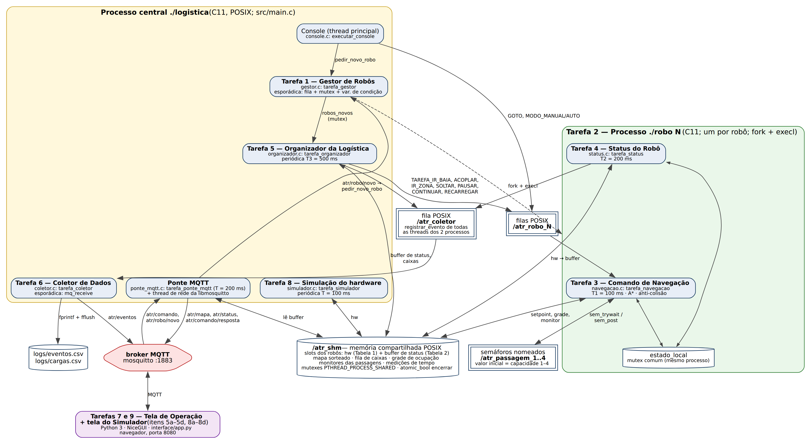

# Logística com robôs móveis (AMRs)

Trabalho Final de Automação em Tempo Real (UFMG, 2026/2, Prof. Leandro Freitas).

Sistema central de logística com robôs móveis autônomos num galpão 2D visto de
cima. Cada caixa vai de uma **baia** (1–4) até uma **zona de entrega** (A–D);
caixas maiores exigem de 1 a 4 robôs juntos, que só **acoplam e erguem a carga
de forma síncrona** quando todos chegaram à baia. O mapa (passagens de
capacidade 1, 2, 3 e 4 e obstáculos) é **sorteado a cada execução** e as rotas
são calculadas com **A\***.

- Núcleo em **C11 + POSIX** (processos, pthreads, mutex, variável de condição,
  semáforos nomeados, filas de mensagens, memória compartilhada).
- **Tela de Operação** (que também é a tela do Simulador) em **Python/NiceGUI**,
  ligada ao núcleo por **MQTT** (broker mosquitto).

Documentos:

| Arquivo | Conteúdo |
|---|---|
| `docs/RELATORIO.pdf` | Relatório da Etapa 2 (arquitetura, conformidade, sincronização, testes, tempo real, pontos extras) |
| `docs/INSTRUCOES.pdf` | Este README em PDF (como compilar e rodar) |
| `docs/EXPLICACAO.md` | Cada mecanismo de sincronização: onde, problema, como, sem ele; simplificações |
| `docs/ESCALABILIDADE.md` | Análise de tempo de resposta e escalonabilidade (gerada pelo benchmark) |
| `docs/GUIA_ENTREVISTA.md` | 40 perguntas prováveis sobre o código, com resposta e arquivo:linha |
| `docs/ROTEIRO_VIDEO.md` | Roteiro do vídeo de 10 minutos |

---

## 1. Arquitetura



```
Processo central ./logistica (C)               Processo ./robo <id> (C, um por robô)
+-------------------------------------------+  +----------------------------------+
| thread principal: Console (stdin)         |  | thread principal: cria e espera  |
| thread Gestor de Robôs     (esporádica)   |  | thread Navegação  (T1 = 100 ms)  |
| thread Organizador         (T3 = 500 ms)  |  | thread Status     (T2 = 200 ms)  |
| thread Coletor de Dados    (esporádica)   |  |   \__ estado_local + mutex __/   |
| thread Simulador do hw     (T  = 100 ms)  |  +----------------------------------+
| thread Ponte MQTT          (T  = 200 ms)  |         ^        |         |
|   + thread de rede da libmosquitto        |         |        |         |
+-------------------------------------------+         |        |         |
   |  fork + execl -----------------------------------+        |         |
   |  fila /atr_robo_<id>  (Organizador/Console -> Navegação)  |         |
   |  fila /atr_coletor   <---- registrar_evento (todos) ------+---------+
   |  semáforos /atr_passagem_1..4  <---- Navegação (sem_trywait/sem_post)
   +--- memória compartilhada /atr_shm  <---- todos os processos
   |      (hw = Tabela 1, buffer de status = Tabela 2, mapa, caixas,
   |       grade de ocupação, monitores das passagens; mutexes PROCESS_SHARED)
   |
   +--- logs/eventos.csv, logs/cargas.csv  (só o Coletor escreve)
   |
 MQTT (mosquitto :1883) <----> Tela de Operação + Simulador (Python/NiceGUI, :8080)
```

| Tarefa do enunciado | Onde |
|---|---|
| 1. Gestor de Robôs | `src/gestor.c: tarefa_gestor` (cria o processo do robô com `fork` + `execl`) |
| 2. Processo de cada robô | `src/robo_main.c: main` (duas threads) |
| 3. Comando de Navegação | `src/navegacao.c: tarefa_navegacao` |
| 4. Status do Robô | `src/status.c: tarefa_status` |
| 5. Organizador da Logística | `src/organizador.c: tarefa_organizador` |
| 6. Coletor de Dados | `src/coletor.c: tarefa_coletor` (+ `src/eventos.c`) |
| 7/9. Tela de Operação (= tela do simulador) | `interface/app.py` e `interface/paineis/` |
| 8. Simulação do hardware e do mapa | `src/simulador.c: tarefa_simulador`, `src/mapa.c: gerar_mapa` |
| Ponte MQTT | `src/ponte_mqtt.c: tarefa_ponte_mqtt` |

---

## 2. Como rodar com Docker (um comando)

Requisitos: Docker Desktop com integração WSL 2, ou Docker dentro do WSL
(`sudo apt install docker.io docker-compose-v2`, usuário no grupo `docker`,
`sudo service docker start`).

Na raiz do repositório (PowerShell ou bash):

```bash
docker compose up --build
```

- Interface: <http://localhost:8080>.
- Mapa fixo: `ATR_SEMENTE=42 docker compose up --build` (bash) ou
  `$env:ATR_SEMENTE=42; docker compose up --build` (PowerShell).
- O broker fica em `localhost:1883` (só a própria máquina). Se a 1883 já está
  em uso (ex.: o mosquitto do WSL): `ATR_PORTA_MQTT=1884 docker compose up --build`.
- O Console do processo central fica no terminal do `docker compose up`
  (digite `status`, `mapa`, `sair`...). Para o Console num terminal só dele:
  `docker compose up -d broker interface` e depois
  `docker compose run --rm logistica`.
- Encerrar: `sair` no Console (limpeza dos objetos de IPC) e `Ctrl+C`, ou
  `docker compose down`. Os logs CSV ficam em `logs/` do repositório.

---

## 3. Como rodar nativo (WSL/Ubuntu)

### 3.1 Instalação (uma vez)

```bash
sudo apt install build-essential libmosquitto-dev mosquitto python3-venv
make
python3 -m venv interface/.venv
interface/.venv/bin/pip install -r interface/requirements.txt
```

### 3.2 Tudo com um comando: `./rodar.sh`

```bash
./rodar.sh                     # mapa sorteado pela hora atual
ATR_SEMENTE=42 ./rodar.sh      # mapa fixo (o do vídeo e dos testes)
./rodar.sh testes/sem_caixas.txt   # começa sem a fila de caixas inicial
```

O script compila se preciso, inicia o **mosquitto** em segundo plano (se
ninguém escuta a porta 1883), inicia a **Tela de Operação** em segundo plano
(saída em `logs/interface.log`) e roda o **`./logistica` em primeiro plano**:
o terminal vira o Console. Abra <http://localhost:8080>. Ao sair (`sair`, fim
da entrada ou `Ctrl+C`), ele mata o que iniciou.

### 3.3 Passo a passo (três terminais)

```bash
# terminal 1: broker (se o serviço do Ubuntu não estiver rodando)
mosquitto
# terminal 2: núcleo em C; o terminal vira o Console
ATR_SEMENTE=42 ./logistica            # ou ./logistica <arquivo_de_caixas>
# terminal 3: Tela de Operação
interface/.venv/bin/python interface/app.py      # http://localhost:8080
```

Todos os caminhos são **relativos à raiz do repositório** (rode daqui).
`./logistica [arquivo]` lê a fila inicial de caixas de `config/caixas.txt`
(formato `id tamanho baia zona`, 3 caixas por baia); `testes/sem_caixas.txt`
começa vazio.

---

## 4. Variáveis de ambiente

| Variável | Quem lê | Efeito | Padrão |
|---|---|---|---|
| `ATR_SEMENTE` | `logistica` (`mapa.c`) | Semente do mapa; mesma semente = mesmo mapa | hora atual |
| `ATR_TEMPO_REAL` | `logistica` e `robo` (`tempo_real.c`) | `1` = SCHED_FIFO com prioridades Rate Monotonic (precisa de permissão; no Docker o `compose.yaml` dá `SYS_NICE`) | desligado |
| `ATR_MQTT_HOST` | `logistica` (`ponte_mqtt.c`) e interface | Endereço do broker (porta 1883 no C) | `localhost` |
| `ATR_MQTT_PORT` | interface | Porta do broker | `1883` |
| `ATR_UI_HOST` / `ATR_UI_PORT` | interface | Endereço/porta da página | `127.0.0.1` / `8080` |
| `ATR_PORTA_MQTT` | `compose.yaml` | Porta do broker no host (Docker) | `1883` |
| `VALORES_N`, `DURACAO` | `testes/escalabilidade.sh` | Valores de N e segundos por N | `1 2 4 … 128`, `60` |

---

## 5. Comandos do Console

Os mesmos comandos são aceitos pelo tópico MQTT `atr/comando` (a tela usa).

| Comando | Efeito |
|---|---|
| `novo [x y]` | Pede um novo robô ao Gestor (sem x/y: posição padrão (8,15)) |
| `status` | Tabela dos robôs (buffer de status) e das caixas pendentes |
| `caixa <tam> <baia> <zona>` | Inclui caixa no fim da fila (tam 1–4, baia 1–4, zona A–D) |
| `falha <id>` / `ok <id>` | Liga/desliga a falha do robô (emula o hardware) |
| `bateria <id> <pct>` | Força a bateria (emula o hardware) |
| `manual <id>` / `auto <id>` | Modo manual / automático |
| `goto <id> <x> <y>` | Setpoint de destino manual (só em modo manual) |
| `mapa` | Desenha o mapa desta execução em texto |
| `historico [n]` | Últimas n linhas (padrão 30, máx. 100) de `logs/eventos.csv` e `logs/cargas.csv` |
| `tempos` / `tempos zerar` | C médio/máximo, atraso, perdas de prazo e U de cada tarefa periódica |
| `espera <s>`, `aguarda <id> <ESTADO> [s]`, `medir_falha <id>` | Só no Console (usados nos testes) |
| `sair` | Encerra tudo com limpeza (o fim da entrada também) |

Estados: `DISPONIVEL`, `DESLOCANDO`, `AGUARDANDO_EQUIPE`, `OPERANDO_CARGA`,
`RECARREGANDO`, `DEFEITO`, `MANUAL`, `DESLIGADO`.

---

## 6. Tópicos MQTT

| Tópico | Quem publica | Conteúdo |
|---|---|---|
| `atr/mapa` | C, retained, ao conectar | JSON do mapa (paredes, passagens com capacidade, obstáculos, baias, zonas, estações, semente) |
| `atr/status` | C (Ponte MQTT), a cada 200 ms | robôs (buffer de status + rota), caixas, passagens (vagas, sentido), contadores |
| `atr/eventos` | C (Coletor), a cada registro | cada linha gravada em `logs/*.csv`, com timestamp |
| `atr/comando` | Tela | uma linha igual à do Console (`falha 2`, `caixa 3 1 A`, `historico 50`...) |
| `atr/robo/novo` | Tela (simulador) | novo robô: `"x y"` ou vazio (posição padrão) |
| `atr/comando/resposta` | C | `ok`, a saída do comando, ou `erro: ...` |

---

## 7. Testes

```bash
make clean && make                               # sem nenhum warning (-Wall -Wextra)
testes/rodar_todos.sh                            # cenários 1–11 (não precisa do broker)
interface/.venv/bin/pip install -r interface/requirements-dev.txt   # uma vez
interface/.venv/bin/python -m pytest -q interface                    # testes da tela
```

`rodar_todos.sh` roda cada cenário pelo Console
(`ATR_SEMENTE=<s> ./logistica testes/sem_caixas.txt < testes/cenarioN.txt`) e
grava em `testes/saidas/` a saída e as linhas novas dos CSVs. Ele avisa se
houve timeout, `COLISAO`, robô em DEFEITO por bateria ou caixa não entregue.
O que cada cenário prova está no relatório (capítulo 5) e em
`docs/EXPLICACAO.md` (seção 10).

## 8. Benchmark de escalabilidade

```bash
testes/escalabilidade.sh normal                  # N = 1..128, ~16 min
ATR_PORTA_MQTT=1884 docker compose run --rm -T -v ./testes:/app/testes \
    logistica testes/escalabilidade.sh rt         # SCHED_FIFO no container
interface/.venv/bin/python testes/analisar_escalabilidade.py   # gráficos + docs/ESCALABILIDADE.md
```

Resposta (detalhes em `docs/ESCALABILIDADE.md`): com este hardware (i5-13420H,
12 núcleos, WSL2) o sistema manteve **zero perdas de prazo e latência de falha
< 300 ms até N = 128 robôs** (o maior testado); a vazão satura em ~15
entregas/min a partir de N ≈ 64 (limite físico: 4 baias); o próximo limite
rígido é o do SO (255 robôs, pelas filas POSIX).

---

## 9. Gerar os PDFs da documentação

Os PDFs (`docs/RELATORIO.pdf`, `docs/INSTRUCOES.pdf`) e a figura
`docs/imagens/arquitetura.png` (fonte Graphviz: `docs/imagens/arquitetura.dot`)
são gerados por `docs/gerar_pdf.py`: **pandoc** (instalado pelo pacote pip
`pypandoc_binary`, sem LaTeX) converte o Markdown em HTML e o **Chromium
headless** do Playwright imprime o PDF. Funciona no WSL sem LaTeX:

```bash
interface/.venv/bin/pip install -r interface/requirements-dev.txt
interface/.venv/bin/playwright install --with-deps chromium   # pede sudo (bibliotecas do Chromium)
interface/.venv/bin/python docs/gerar_pdf.py                   # precisa de internet (Graphviz-WASM do CDN)
```

Sem sudo, `playwright install chromium` baixa o navegador e só faltam
`libnss3`, `libnspr4` e `libasound2` (`sudo apt install libnss3 libasound2t64`).

## 10. Entrega

```bash
./empacotar.sh     # gera ATR_TrabalhoFinal.zip (git archive: sem .git, binários, .venv, logs/)
```
