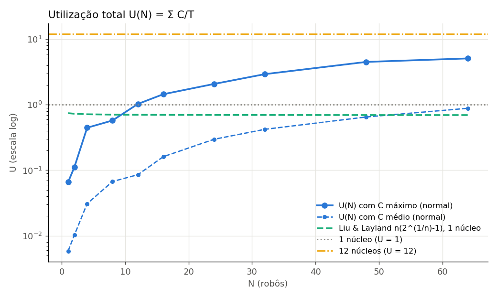
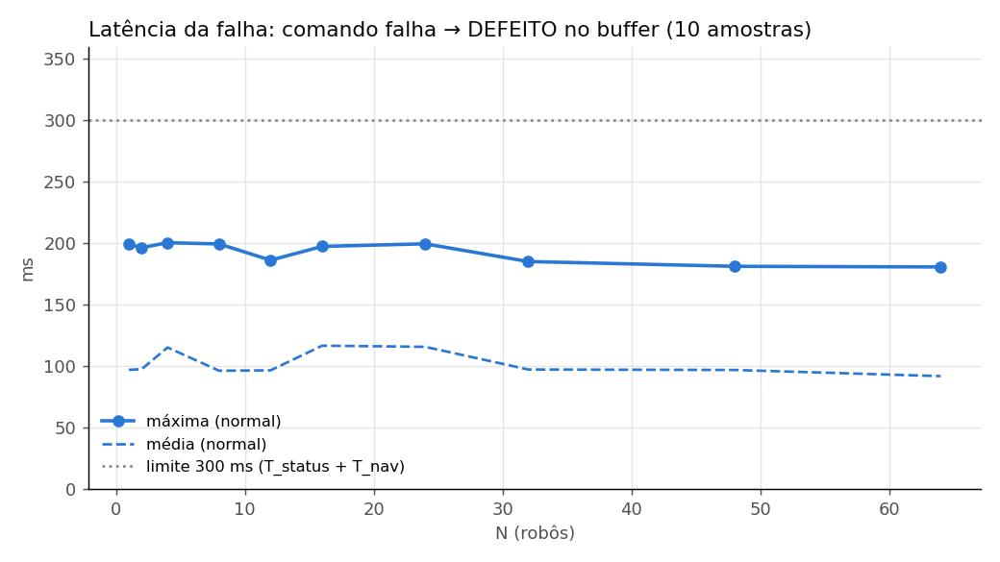

# Análise de tempo de resposta e escalabilidade

> Gerado por `testes/analisar_escalabilidade.py` a partir de `testes/saidas/escalabilidade.csv` (benchmark `testes/escalabilidade.sh`). Não editar à mão: rode o benchmark e o script de novo.

**Pergunta do enunciado:** num dado cenário, qual o número máximo de robôs que é possível gerir com o hardware utilizado garantindo corretude e responsividade?

## Resposta

**Com o hardware 13th Gen Intel(R) Core(TM) i5-13420H (12 núcleos lógicos, WSL2), o número máximo de robôs que mantém zero perdas de prazo e latência de falha abaixo de 300 ms (T_status + T_nav) é N = 64** — o maior valor testado (MAX_ROBOS = 64 é o limite do sistema). O processador não foi o gargalo: com 64 robôs a utilização total medida é U = 5.09, isto é, 42% da capacidade de 12 núcleos. Pela extrapolação linear de U(N) (seção Extrapolação), o limite do processador estaria bem acima disso.

Para comparação, se tudo rodasse em **um núcleo só**, a RTA com os C máximos medidos garante até **N = 8** (seção RTA). Os 12 núcleos são o que permite chegar a 64 sem perdas.

### Critério escolhido

- **Corretude temporal = zero perdas de prazo** em TODAS as tarefas periódicas (deadline = período; uma perda é um ciclo que terminou depois de `proximo + T`). Se a Navegação perde prazo, o setpoint chega atrasado ao simulador e a anti-colisão (que decide passo a passo) trabalha com informação velha.
- **Responsividade = latência do evento crítico < 300 ms.** O evento mais crítico é a falha de um robô: entre o hardware ligar `i_falha` e o robô estar PARADO passam, no pior caso, um período da Status (que detecta e publica DEFEITO) + um período da Navegação (que segura a posição): 200 + 100 = 300 ms. Medimos até o buffer mostrar DEFEITO (o que o Organizador e a tela enxergam); se isso passar de 300 ms é porque alguém atrasou além do projeto.
- Os dois critérios têm de valer para o N e para todos os menores (escalabilidade monótona); cada N roda 60 s com 2N caixas sendo transportadas (cenário realista: equipes, passagens, recargas).

## Resultados medidos (modo normal, SCHED_OTHER)

C e atraso em µs; Navegação e Status = pior robô. U(N) = Σ centrais + N·(C_nav/T_nav + C_status/T_status), calculada com o C máximo (pior caso, usada nos testes) e com o C médio (carga típica). A diferença grande entre as duas vem de picos isolados de C máximo (preempção pelo Windows/WSL), não do trabalho normal do ciclo.

| N | C_nav méd/máx | C_status méd/máx | C_sim máx | C_org méd/máx | C_ponte máx | atraso máx (tarefa) | perdas | U(N) Cmáx / Cméd | lat. falha méd/máx (ms) |
|---|---|---|---|---|---|---|---|---|---|
| 1 | 27 / 3464 | 677 / 2659 | 40 | 862 / 8164 | 238 | 1061 (ponte_mqtt) | 0 | 0.066 / 0.006 | 97 / 199 |
| 2 | 27 / 2270 | 239 / 3523 | 61 | 3484 / 14670 | 343 | 560 (status) | 0 | 0.112 / 0.010 | 98 / 196 |
| 4 | 38 / 6983 | 828 / 6116 | 143 | 6026 / 20340 | 374 | 9121 (navegacao) | 0 | 0.446 / 0.031 | 115 / 200 |
| 8 | 51 / 3592 | 1215 / 5936 | 172 | 6749 / 23020 | 439 | 9986 (navegacao) | 0 | 0.575 / 0.067 | 96 / 200 |
| 12 | 58 / 5277 | 1185 / 5809 | 395 | 3106 / 18934 | 854 | 3890 (navegacao) | 0 | 1.028 / 0.085 | 97 / 186 |
| 16 | 51 / 5494 | 1858 / 6440 | 433 | 1514 / 22629 | 498 | 1354 (navegacao) | 0 | 1.446 / 0.161 | 117 / 198 |
| 24 | 56 / 4663 | 2307 / 7405 | 101 | 2537 / 31084 | 834 | 1890 (navegacao) | 0 | 2.075 / 0.297 | 116 / 200 |
| 32 | 183 / 5711 | 2222 / 6413 | 164 | 2692 / 34961 | 534 | 4440 (navegacao) | 0 | 2.928 / 0.421 | 97 / 185 |
| 48 | 218 / 5750 | 2234 / 6858 | 82 | 3901 / 46747 | 530 | 3483 (navegacao) | 0 | 4.503 / 0.650 | 97 / 181 |
| 64 | 318 / 4175 | 2099 / 7259 | 191 | 2481 / 44205 | 782 | 3213 (status) | 0 | 5.089 / 0.882 | 92 / 181 |

### Modo tempo real (ATR_TEMPO_REAL=1)

Não executado nesta máquina: o usuário não tem permissão para SCHED_FIFO (`normal (ATR_TEMPO_REAL=0); ulimit -r = 0`; `chrt -f 1 true` falha com EPERM). O código está pronto: `ATR_TEMPO_REAL=1 ./logistica` como root, ou no Docker (o `compose.yaml` dá `cap_add: SYS_NICE`), e depois `testes/escalabilidade.sh rt`.

## Teste de utilização (Liu & Layland)

Para n tarefas periódicas independentes com Rate Monotonic num processador, U ≤ n(2^(1/n) − 1) é condição SUFICIENTE de escalonabilidade (o limite tende a ln 2 ≈ 0,693). Com N robôs, n = 3 + 2N.

| N | n tarefas | U(N) | limite L&L | passa no L&L (1 núcleo)? |
|---|---|---|---|---|
| 1 | 5 | 0.066 | 0.743 | sim |
| 2 | 7 | 0.112 | 0.729 | sim |
| 4 | 11 | 0.446 | 0.715 | sim |
| 8 | 19 | 0.575 | 0.706 | sim |
| 12 | 27 | 1.028 | 0.702 | não (teste inconclusivo) |
| 16 | 35 | 1.446 | 0.700 | não (teste inconclusivo) |
| 24 | 51 | 2.075 | 0.698 | não (teste inconclusivo) |
| 32 | 67 | 2.928 | 0.697 | não (teste inconclusivo) |
| 48 | 99 | 4.503 | 0.696 | não (teste inconclusivo) |
| 64 | 131 | 5.089 | 0.695 | não (teste inconclusivo) |

Este computador tem 12 núcleos e o Linux distribui as threads entre eles (escalonamento global). O L&L é de 1 núcleo, então ele é PESSIMISTA aqui: mesmo que U(N) passe do limite de 1 núcleo, a carga cabe com folga em 12 (U ≪ 12). Ele serve como referência de "se tudo rodasse num núcleo só".

## Análise de tempo de resposta (RTA)

Teste EXATO para prioridade fixa (1 processador, deadline = período): para cada tarefa i,

    R_i = C_i + Σ_{j ∈ hp(i)} ⌈R_i / T_j⌉ · C_j

iterando a partir de R⁰ = Σ C até R parar de mudar; a tarefa é escalonável se R_i ≤ T_i. hp(i) = tarefas de prioridade maior (Rate Monotonic: Navegações e Simulador, T = 100 ms; Status e Ponte, 200 ms; Organizador, 500 ms). Usamos os **C máximos medidos** (pior caso observado). A tarefa de MENOR prioridade (Organizador) sofre a interferência de todas as outras: se ela passa, todas passam (as outras têm menos interferência e o mesmo critério).

### Passo a passo: Organizador com N = 8 (tudo num núcleo só)

C (ms): Navegação = 3.592 (×8), Simulador = 0.172, Status = 5.936 (×8), Ponte = 0.439, Organizador = 23.020.

R^(k+1) = 23.020 + ⌈R^k/100⌉·(8·3.592 + 0.172) + ⌈R^k/200⌉·(8·5.936 + 0.439),  R^0 = Σ C

| iteração k | R^k (ms) |
|---|---|
| 0 | 99.855 |

R^0 = 99.855 ms já é menor que o menor período (100 ms): nenhuma tarefa de maior prioridade é liberada de novo antes de o Organizador terminar, então R^1 = R^0 (convergiu). R = 99.855 ms ≤ 500 ms → **escalonável**.

### Passo a passo: Organizador com N = 12 (tudo num núcleo só)

C (ms): Navegação = 5.277 (×12), Simulador = 0.395, Status = 5.809 (×12), Ponte = 0.854, Organizador = 18.934.

R^(k+1) = 18.934 + ⌈R^k/100⌉·(12·5.277 + 0.395) + ⌈R^k/200⌉·(12·5.809 + 0.854),  R^0 = Σ C

| iteração k | R^k (ms) |
|---|---|
| 0 | 153.218 |
| 1 | 216.935 |
| 2 | 351.218 |
| 3 | 414.935 |
| 4 | 549.219 |

R passou de T = 500 ms (549.219 ms) → **NÃO escalonável** em um núcleo: a cada 100 ms as Navegações e o Simulador voltam, a cada 200 ms as Status e a Ponte, e o Organizador não termina a tempo.

### RTA para todos os N (1 núcleo, C máximo)

R de cada grupo = R da ÚLTIMA tarefa daquele período na ordem de prioridade (Simulador para T = 100 ms, Ponte para T = 200 ms), que sofre mais interferência.

| N | R (T = 100 ms) | R (T = 200 ms) | R_organizador (ms) | escalonável em 1 núcleo? |
|---|---|---|---|---|
| 1 | 3.50 | 6.40 | 14.57 | sim |
| 2 | 4.60 | 11.99 | 26.66 | sim |
| 4 | 28.08 | 52.91 | 73.25 | sim |
| 8 | 28.91 | 76.83 | 99.85 | sim |
| 12 | 63.72 | 198.00 | 549.22 | não |
| 16 | 88.33 | 280.20 | 774.91 | não |
| 24 | 223.93 | 692.32 | 836.25 | não |
| 32 | 365.66 | 1142.62 | 1566.79 | não |
| 48 | 828.15 | 3250.01 | 3298.34 | não |
| 64 | 801.83 | 3998.42 | 4044.97 | não |

Se TUDO rodasse num núcleo só, com os C máximos medidos, o maior N garantido pela RTA seria **N = 8**. Com 12 núcleos a RTA clássica não se aplica diretamente (escalonamento global), e o que vale é a medição: zero perdas até N = 64. A RTA de 1 núcleo é muito pessimista porque soma os PICOS de C (raros e de causas externas) de todas as tarefas como se acontecessem juntos.

## Extrapolação (até onde iria o processador)

Entre N = 48 e N = 64, cada robô a mais soma ≈ 0.0366 de utilização com C máximo (≈ 0.0145 com C médio). Extrapolando linearmente, U = 12 (todos os núcleos cheios) seria atingido em N ≈ 253 pelo pior caso e N ≈ 832 pela carga média. É uma estimativa grosseira: o custo do Organizador e do A* cresce mais que linearmente com a ocupação do mapa, e o mapa de 60×30 (com obstáculos, passagens de capacidade 1 a 4) fica congestionado antes disso. Na prática o limite de verdade passa a ser o ESPAÇO (robôs esperando célula/passagem), não a CPU.

## Limitações

- **Linux não é um RTOS.** Mesmo com SCHED_FIFO não há garantia de pior caso: interrupções, page faults, o próprio kernel e o "RT throttling" (95% da CPU no máximo para tarefas de tempo real) podem atrasar qualquer thread.
- **Medições em SCHED_OTHER** sofrem interferência de todos os outros processos da máquina (navegador, IDE, antivírus do Windows): o atraso máximo é dominado por isso, não pelo nosso sistema.
- **WSL2 é uma máquina virtual** (Hyper-V): o núcleo Linux pode perder a CPU para o Windows a qualquer momento; no Docker há ainda mais uma camada. Isso adiciona ruído aos C máximos (picos isolados).
- **C máximo observado ≠ WCET.** 60 s por N é uma amostra; um caminho de código raro (A* num mapa congestionado) pode demorar mais. Por isso usamos margem: o critério é zero perdas, e a RTA usa o máximo, não a média.
- **Latência da falha**: 10 amostras por N, com resolução de 1 ms (o Console consulta o buffer a cada 1 ms). Ela é dominada pela FASE do ciclo da Status (0 a 200 ms), não pela carga.
- **RTA de 1 núcleo**: o sistema roda em vários núcleos com escalonamento global, para o qual a RTA clássica não vale diretamente; usá-la como se fosse 1 núcleo é conservador (se passa em 1, passa em mais). Também ignora bloqueio por mutex (seções críticas curtas, de cópia) e o custo de troca de contexto.
- O benchmark roda sem a Tela de Operação (a ponte MQTT publica para o broker local, mas ninguém desenha 64 robôs).

## Hardware e ambiente

- data: `2026-11-14 18:27:20`
- nproc: `12`
- cpu: `13th Gen Intel(R) Core(TM) i5-13420H`
- uname: `Linux PabloReis 6.18.58.1-microsoft-standard-WSL2 #1 SMP PREEMPT_DYNAMIC Tue Oct 27 00:24:11 UTC 2026 x86_64 GNU/Linux`
- modo: `normal (ATR_TEMPO_REAL=0); ulimit -r = 0`

## Como reproduzir

    testes/escalabilidade.sh           # ~12 min por modo; grava testes/saidas/escalabilidade*
    interface/.venv/bin/python testes/analisar_escalabilidade.py
