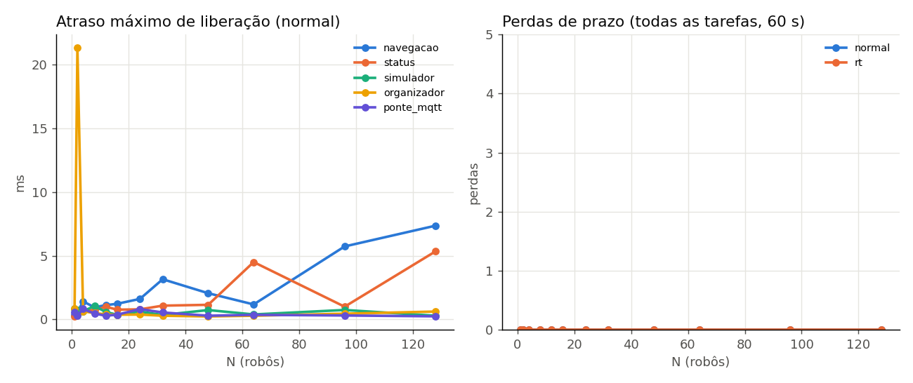

# Análise de tempo de resposta e escalabilidade

> Gerado por `testes/analisar_escalabilidade.py` a partir de `testes/saidas/escalabilidade.csv` (benchmark `testes/escalabilidade.sh`). Não editar à mão: rode o benchmark e o script de novo.

**Pergunta do enunciado:** num dado cenário, qual o número máximo de robôs que é possível gerir com o hardware utilizado garantindo corretude e responsividade?

## Resposta

### a) Limite de processamento (CPU)

Reta medida em N = 128 (o maior testado; Navegação e Status = pior robô):

    U(N) = U_central + N·(C_nav/T_nav + C_status/T_status)

| C usado | U_central | C_nav (µs) | C_status (µs) | custo por robô | N com U = 12 núcleos |
|---|---|---|---|---|---|
| máximo (pior caso) | 0.1059 | 4248 | 11696 | 0.10096 | **118** |
| médio (carga típica) | 0.0097 | 30 | 1756 | 0.00908 | **1320** |

Com o C máximo (pico de UM robô somado como se TODOS tivessem o pico em todo ciclo) a CPU encheria em N ≈ 118; com o C médio, em N ≈ 1320. Se tudo rodasse em **um núcleo só**, a RTA com os C máximos garante só até **N = 8** (seção RTA). É uma estimativa: o Organizador e o A* crescem mais que linearmente com a ocupação do mapa, e a reta ignora troca de contexto e cache.

### b) Limite do software e do sistema operacional

| recurso | uso com N robôs | limite | N máximo por esse recurso |
|---|---|---|---|
| `MAX_ROBOS` (comum.h, slots de /atr_shm, ids) | N | 128 | 128 (é só recompilar) |
| filas POSIX (`/proc/sys/fs/mqueue/queues_max`) | N + 1 (/atr_robo_* + /atr_coletor) | 256 | 255 |
| bytes de fila (`RLIMIT_MSGQUEUE`, `ulimit -q`) | ~1360 B por robô + 2560 B | 819200 B | 600 |
| tarefas do Linux (`ulimit -u`: processos + threads) | 3 por robô (main, Navegação, Status) | 31141 | 10380 |
| memória (RSS medido: média de `ps -o rss= -C robo` com N = 128; PSS ≈ 180 KB) | ~2.1 MB por robô | 7794 MB | 3627 |
| `TAMANHO_JSON` (ponte MQTT) | ~600 B por robô + ~110 B por caixa | 256 KB | ~389 |

Ao testar 96 e 128 robôs: 129 filas abertas, nenhum `mq_open` falhou, nenhum JSON descartado. A posição padrão (8,15) é estacionamento, então todos os robôs nasceram nela ("realocados" conta os que o Gestor teria posto em outra célula):

| N | robôs realocados | pedidos recusados | COLISAO | perdas de prazo |
|---|---|---|---|---|
| 48 | 0 | 0 | 0 | 0 |
| 64 | 0 | 0 | 0 | 0 |
| 96 | 0 | 0 | 0 | 0 |
| 128 | 0 | 0 | 0 | 0 |

O primeiro limite do software é o próprio `MAX_ROBOS` = 128; o primeiro limite do SO que apareceria é o `queues_max` = 256 (no máximo 255 robôs, porque cada um tem a sua fila). Ele pode ser aumentado como root (`sysctl fs.mqueue.queues_max=...`), e aí o seguinte é o `RLIMIT_MSGQUEUE`.

### c) Limite físico do galpão (vazão)

Entregas por minuto e tempo médio de entrega (da atribuição, "indo para a baia", até o SOLTAR, pelos timestamps do Coletor), contando só as entregas dos últimos 40 s da janela de 60 s (os primeiros 20 s são aquecimento). A fila tem max(2N, 64) caixas e nunca esvaziou na janela (coluna "fila").

| N | entregas na janela | entregas/min | tempo médio (s) | tempo máx (s) | fila |
|---|---|---|---|---|---|
| 1 | 2 | 3.0 | 17.5 | 18.5 | nunca vazia |
| 2 | 2 | 3.0 | 24.0 | 28.0 | nunca vazia |
| 4 | 1 | 1.5 | 35.1 | 35.1 | nunca vazia |
| 8 | 4 | 6.0 | 26.4 | 33.5 | nunca vazia |
| 12 | 7 | 10.5 | 26.1 | 35.5 | nunca vazia |
| 16 | 6 | 9.0 | 22.7 | 30.0 | nunca vazia |
| 24 | 8 | 12.0 | 19.9 | 23.5 | nunca vazia |
| 32 | 9 | 13.5 | 17.7 | 23.5 | nunca vazia |
| 48 | 9 | 13.5 | 18.8 | 23.5 | nunca vazia |
| 64 | 10 | 15.0 | 17.7 | 23.5 | nunca vazia |
| 96 | 10 | 15.0 | 17.7 | 23.5 | nunca vazia |
| 128 | 10 | 15.0 | 17.7 | 23.5 | nunca vazia |

A vazão máxima foi 15.0 entregas/min. A partir de **N = 32** ela já está em 90% desse máximo, e a partir de N = 64 é exatamente a mesma: **mais robôs não aumentam a vazão**. O motivo é o galpão: há 4 baias e o Organizador põe **uma carga por baia de cada vez**, então no máximo 4 entregas andam ao mesmo tempo (de 4 a 16 robôs trabalhando; o tamanho médio das caixas é 2,5, mais os que estão recarregando). Os outros ficam DISPONIVEL **no estacionamento** (posição padrão, zonas, estações; ver docs/EXPLICACAO.md 8.5) e não atrapalham ninguém: com a semente fixa o Organizador escolhe sempre os mesmos robôs (os mais perto da baia), e por isso os números com N grande são iguais. Com N pequeno a vazão é menor e o tempo maior porque falta robô livre perto da baia (a caixa de tamanho 4 espera os 4, e cada robô volta da zona, do outro lado do mapa). Antes do estacionamento dos ociosos, com N = 128 os robôs parados em volta das baias travavam o galpão: zero entregas.

### Conclusão

**Com este hardware, o sistema garante corretude e responsividade para até N = 128 robôs; o fator que limita é o galpão, e não a CPU nem o SO: a partir de N ≈ 64 a vazão para de crescer (15 entregas/min, 4 baias com uma carga cada), e o primeiro limite rígido acima de 128 é o SO (255 robôs, pelas filas POSIX).**

- N = 128 é o maior valor testado (= `MAX_ROBOS`), com zero perdas de prazo, latência da falha < 300 ms, zero COLISAO, nenhum pedido recusado e nenhum deadlock (todas as rodadas entregaram caixas até o fim).
- A CPU tem folga: com 128 robôs a carga média é U = 1.17 de 12 núcleos. A reta com o C MÁXIMO chega aos 12 núcleos em N ≈ 118, abaixo do que foi medido sem perdas: ela soma o pico de cada tarefa (de robôs e instantes diferentes) como se todos acontecessem juntos em todo ciclo, o que não acontece. É um limite pessimista, não uma garantia de falha.
- Para um só núcleo, a RTA com os C máximos garante só N = 8.
- Robôs além de N ≈ 64 são gerenciáveis mas inúteis: ficam no estacionamento. Para aumentar a vazão seria preciso mudar o galpão (mais baias, ou mais de uma carga por baia), não o computador.

### Critério escolhido

- **Corretude temporal = zero perdas de prazo** em TODAS as tarefas periódicas (deadline = período; uma perda é um ciclo que terminou depois de `proximo + T`). Se a Navegação perde prazo, o setpoint chega atrasado ao simulador e a anti-colisão (que decide passo a passo) trabalha com informação velha.
- **Responsividade = latência do evento crítico < 300 ms.** O evento mais crítico é a falha de um robô: entre o hardware ligar `i_falha` e o robô estar PARADO passam, no pior caso, um período da Status (que detecta e publica DEFEITO) + um período da Navegação (que segura a posição): 200 + 100 = 300 ms. Medimos até o buffer mostrar DEFEITO (o que o Organizador e a tela enxergam); se isso passar de 300 ms é porque alguém atrasou além do projeto.
- Os dois critérios têm de valer para o N e para todos os menores (escalabilidade monótona); cada N roda 60 s com max(2N, 64) caixas sendo transportadas (cenário realista: equipes, passagens, recargas).

## Resultados medidos (modo normal, SCHED_OTHER)

C e atraso em µs; Navegação e Status = pior robô. U(N) = Σ centrais + N·(C_nav/T_nav + C_status/T_status), calculada com o C máximo (pior caso, usada nos testes) e com o C médio (carga típica). A diferença grande entre as duas vem de picos isolados de C máximo (preempção pelo Windows/WSL), não do trabalho normal do ciclo.

| N | C_nav méd/máx | C_status méd/máx | C_sim máx | C_org méd/máx | C_ponte máx | atraso máx (tarefa) | perdas | U(N) Cmáx / Cméd | lat. falha méd/máx (ms) |
|---|---|---|---|---|---|---|---|---|---|
| 1 | 41 / 3407 | 129 / 2866 | 625 | 4328 / 20388 | 501 | 850 (organizador) | 0 | 0.098 / 0.012 | 113 / 198 |
| 2 | 38 / 4584 | 294 / 4167 | 91 | 8787 / 43801 | 281 | 21290 (organizador) | 0 | 0.223 / 0.022 | 113 / 192 |
| 4 | 39 / 5534 | 1294 / 5019 | 458 | 6766 / 17382 | 690 | 1420 (navegacao) | 0 | 0.365 / 0.042 | 96 / 191 |
| 8 | 50 / 5938 | 1064 / 4961 | 348 | 8931 / 56120 | 517 | 1050 (simulador) | 0 | 0.792 / 0.066 | 114 / 197 |
| 12 | 46 / 4819 | 1552 / 6102 | 192 | 2254 / 32035 | 732 | 1126 (navegacao) | 0 | 1.014 / 0.105 | 116 / 199 |
| 16 | 69 / 6043 | 1987 / 5893 | 212 | 1318 / 34344 | 527 | 1233 (navegacao) | 0 | 1.512 / 0.174 | 115 / 194 |
| 24 | 40 / 6165 | 1900 / 5558 | 171 | 2172 / 45842 | 466 | 1615 (navegacao) | 0 | 2.242 / 0.243 | 113 / 200 |
| 32 | 30 / 3796 | 1955 / 5527 | 184 | 2648 / 38183 | 567 | 3156 (navegacao) | 0 | 2.180 / 0.329 | 113 / 202 |
| 48 | 36 / 4951 | 2013 / 5564 | 233 | 2253 / 34942 | 495 | 2061 (navegacao) | 0 | 3.786 / 0.507 | 113 / 200 |
| 64 | 30 / 4086 | 2423 / 6054 | 190 | 3000 / 43920 | 511 | 4503 (status) | 0 | 4.645 / 0.803 | 112 / 204 |
| 96 | 38 / 4456 | 2569 / 12798 | 495 | 3676 / 61470 | 767 | 5728 (navegacao) | 0 | 10.553 / 1.280 | 108 / 203 |
| 128 | 30 / 4248 | 1756 / 11696 | 603 | 3312 / 48076 | 734 | 7356 (navegacao) | 0 | 13.029 / 1.172 | 107 / 202 |

### Modo tempo real (ATR_TEMPO_REAL=1, SCHED_FIFO) × modo normal

Rodado no Docker (`rt (ATR_TEMPO_REAL=1); ulimit -r = 0`; uname `Linux e5ccfcedd2c8 6.18.58.1-microsoft-standard-WSL2 #1 SMP PREEMPT_DYNAMIC Tue Oct 27 00:24:11 UTC 2026 x86_64 GNU/Linux`), com o comando:

    docker compose run --rm -T -v ./testes:/app/testes logistica testes/escalabilidade.sh rt

C máx = pior tarefa periódica (µs); atraso = atraso máximo de liberação entre todas as tarefas (µs); lat. = latência máxima da falha (ms).

| N | C_nav máx normal / rt | C_status máx normal / rt | C_org máx normal / rt | atraso máx normal / rt | perdas normal / rt | lat. máx normal / rt | entregas/min normal / rt |
|---|---|---|---|---|---|---|---|
| 1 | 3407 / 2572 | 2866 / 3584 | 20388 / 19206 | 850 / 1028 | 0 / 0 | 198 / 199 | 3.0 / 3.0 |
| 2 | 4584 / 4402 | 4167 / 5036 | 43801 / 22310 | 21290 / 799 | 0 / 0 | 192 / 194 | 3.0 / 3.0 |
| 4 | 5534 / 3766 | 5019 / 5128 | 17382 / 27924 | 1420 / 1143 | 0 / 0 | 191 / 199 | 1.5 / 1.5 |
| 8 | 5938 / 4809 | 4961 / 4840 | 56120 / 35865 | 1050 / 1157 | 0 / 0 | 197 / 201 | 6.0 / 6.0 |
| 12 | 4819 / 5431 | 6102 / 5385 | 32035 / 25010 | 1126 / 1209 | 0 / 0 | 199 / 202 | 10.5 / 10.5 |
| 16 | 6043 / 6032 | 5893 / 5164 | 34344 / 22586 | 1233 / 1290 | 0 / 0 | 194 / 199 | 9.0 / 9.0 |
| 24 | 6165 / 4601 | 5558 / 6426 | 45842 / 44620 | 1615 / 1461 | 0 / 0 | 200 / 203 | 12.0 / 13.5 |
| 32 | 3796 / 4099 | 5527 / 5919 | 38183 / 47677 | 3156 / 1375 | 0 / 0 | 202 / 202 | 13.5 / 13.5 |
| 48 | 4951 / 3284 | 5564 / 6432 | 34942 / 66033 | 2061 / 5650 | 0 / 0 | 200 / 202 | 13.5 / 15.0 |
| 64 | 4086 / 5153 | 6054 / 6666 | 43920 / 40882 | 4503 / 1131 | 0 / 0 | 204 / 201 | 15.0 / 15.0 |
| 96 | 4456 / 3586 | 12798 / 7354 | 61470 / 52352 | 5728 / 4946 | 0 / 0 | 203 / 174 | 15.0 / 15.0 |
| 128 | 4248 / 3204 | 11696 / 9782 | 48076 / 34951 | 7356 / 4349 | 0 / 0 | 202 / 179 | 15.0 / 15.0 |

**Comparação.** Perdas de prazo: 0 no modo normal e 0 no rt, em todos os N. O pior atraso de liberação caiu de 21.3 ms (normal) para 5.6 ms (rt), e foi menor no rt em 7 de 12 valores de N: com SCHED_FIFO uma tarefa pronta não espera atrás de processos comuns da máquina (navegador, IDE). O C máximo da Status com N grande também caiu (N = 128: 11696 → 9782 µs). A latência da falha e a vazão praticamente não mudam: a latência é dominada pela FASE do ciclo de 200 ms da Status (0 a 200 ms), e a vazão pelas 4 baias, não pela CPU. Ou seja: com esta carga (U médio ≈ 1 de 12 núcleos) o modo normal já é suficiente; o tempo real diminui a cauda dos atrasos, que é o que importaria com a máquina mais carregada. Os C máximos continuam com picos isolados nos dois modos: o WSL2 é uma máquina virtual e o Windows pode tirar a CPU do Linux inteiro, coisa que nenhuma prioridade dentro do Linux impede.

## Teste de utilização (Liu & Layland)

Para n tarefas periódicas independentes com Rate Monotonic num processador, U ≤ n(2^(1/n) − 1) é condição SUFICIENTE de escalonabilidade (o limite tende a ln 2 ≈ 0,693). Com N robôs, n = 3 + 2N.

| N | n tarefas | U(N) | limite L&L | passa no L&L (1 núcleo)? |
|---|---|---|---|---|
| 1 | 5 | 0.098 | 0.743 | sim |
| 2 | 7 | 0.223 | 0.729 | sim |
| 4 | 11 | 0.365 | 0.715 | sim |
| 8 | 19 | 0.792 | 0.706 | não (teste inconclusivo) |
| 12 | 27 | 1.014 | 0.702 | não (teste inconclusivo) |
| 16 | 35 | 1.512 | 0.700 | não (teste inconclusivo) |
| 24 | 51 | 2.242 | 0.698 | não (teste inconclusivo) |
| 32 | 67 | 2.180 | 0.697 | não (teste inconclusivo) |
| 48 | 99 | 3.786 | 0.696 | não (teste inconclusivo) |
| 64 | 131 | 4.645 | 0.695 | não (teste inconclusivo) |
| 96 | 195 | 10.553 | 0.694 | não (teste inconclusivo) |
| 128 | 259 | 13.029 | 0.694 | não (teste inconclusivo) |

Este computador tem 12 núcleos e o Linux distribui as threads entre eles (escalonamento global). O L&L é de 1 núcleo, então ele é PESSIMISTA aqui: mesmo que U(N) passe do limite de 1 núcleo, a carga cabe com folga em 12 (U ≪ 12). Ele serve como referência de "se tudo rodasse num núcleo só".

## Análise de tempo de resposta (RTA)

Teste EXATO para prioridade fixa (1 processador, deadline = período): para cada tarefa i,

    R_i = C_i + Σ_{j ∈ hp(i)} ⌈R_i / T_j⌉ · C_j

iterando a partir de R⁰ = Σ C até R parar de mudar; a tarefa é escalonável se R_i ≤ T_i. hp(i) = tarefas de prioridade maior (Rate Monotonic: Navegações e Simulador, T = 100 ms; Status e Ponte, 200 ms; Organizador, 500 ms). Usamos os **C máximos medidos** (pior caso observado). A tarefa de MENOR prioridade (Organizador) sofre a interferência de todas as outras: se ela passa, todas passam (as outras têm menos interferência e o mesmo critério).

### Passo a passo: Organizador com N = 8 (tudo num núcleo só)

C (ms): Navegação = 5.938 (×8), Simulador = 0.347, Status = 4.961 (×8), Ponte = 0.517, Organizador = 56.120.

R^(k+1) = 56.120 + ⌈R^k/100⌉·(8·5.938 + 0.347) + ⌈R^k/200⌉·(8·4.961 + 0.517),  R^0 = Σ C

| iteração k | R^k (ms) |
|---|---|
| 0 | 144.175 |
| 1 | 192.023 |

Convergiu: R = 192.023 ms ≤ 500 ms → **escalonável**.

### Passo a passo: Organizador com N = 12 (tudo num núcleo só)

C (ms): Navegação = 4.819 (×12), Simulador = 0.192, Status = 6.101 (×12), Ponte = 0.732, Organizador = 32.035.

R^(k+1) = 32.035 + ⌈R^k/100⌉·(12·4.819 + 0.192) + ⌈R^k/200⌉·(12·6.101 + 0.732),  R^0 = Σ C

| iteração k | R^k (ms) |
|---|---|
| 0 | 164.002 |
| 1 | 222.019 |
| 2 | 353.986 |
| 3 | 412.002 |
| 4 | 543.969 |

R passou de T = 500 ms (543.969 ms) → **NÃO escalonável** em um núcleo: a cada 100 ms as Navegações e o Simulador voltam, a cada 200 ms as Status e a Ponte, e o Organizador não termina a tempo.

### RTA para todos os N (1 núcleo, C máximo)

R de cada grupo = R da ÚLTIMA tarefa daquele período na ordem de prioridade (Simulador para T = 100 ms, Ponte para T = 200 ms), que sofre mais interferência.

| N | R (T = 100 ms) | R (T = 200 ms) | R_organizador (ms) | escalonável em 1 núcleo? |
|---|---|---|---|---|
| 1 | 4.03 | 7.40 | 27.79 | sim |
| 2 | 9.26 | 17.87 | 61.67 | sim |
| 4 | 22.59 | 43.36 | 60.74 | sim |
| 8 | 47.85 | 88.06 | 192.02 | sim |
| 12 | 58.02 | 189.98 | 543.97 | não |
| 16 | 96.89 | 288.60 | 514.66 | não |
| 24 | 296.09 | 711.65 | 906.08 | não |
| 32 | 243.15 | 719.30 | 879.72 | não |
| 48 | 713.12 | 2228.88 | 2264.81 | não |
| 64 | 784.78 | 3382.35 | 3427.80 | não |
| 96 | 2139.33 | 18338.94 | 18834.81 | não |
| 128 | 3263.30 | 27900.38 | 27955.80 | não |

Se TUDO rodasse num núcleo só, com os C máximos medidos, o maior N garantido pela RTA seria **N = 8**. Com 12 núcleos a RTA clássica não se aplica diretamente (escalonamento global), e o que vale é a medição: zero perdas até N = 128. A RTA de 1 núcleo é muito pessimista porque soma os PICOS de C (raros e de causas externas) de todas as tarefas como se acontecessem juntos.

## Limitações

- **Linux não é um RTOS.** Mesmo com SCHED_FIFO não há garantia de pior caso: interrupções, page faults, o próprio kernel e o "RT throttling" (95% da CPU no máximo para tarefas de tempo real) podem atrasar qualquer thread.
- **Medições em SCHED_OTHER** sofrem interferência de todos os outros processos da máquina (navegador, IDE, antivírus do Windows): o atraso máximo é dominado por isso, não pelo nosso sistema.
- **WSL2 é uma máquina virtual** (Hyper-V): o núcleo Linux pode perder a CPU para o Windows a qualquer momento; no Docker há ainda mais uma camada. Isso adiciona ruído aos C máximos (picos isolados).
- **C máximo observado ≠ WCET.** 60 s por N é uma amostra; um caminho de código raro (A* num mapa congestionado) pode demorar mais. Por isso usamos margem: o critério é zero perdas, e a RTA usa o máximo, não a média.
- **Latência da falha**: 10 amostras por N, com resolução de 1 ms (o Console consulta o buffer a cada 1 ms). Ela é dominada pela FASE do ciclo da Status (0 a 200 ms), não pela carga.
- **RTA de 1 núcleo**: o sistema roda em vários núcleos com escalonamento global, para o qual a RTA clássica não vale diretamente; usá-la como se fosse 1 núcleo é conservador (se passa em 1, passa em mais). Também ignora bloqueio por mutex (seções críticas curtas, de cópia) e o custo de troca de contexto.
- O benchmark roda sem a Tela de Operação (a ponte MQTT publica para o broker local, mas ninguém desenha 128 robôs).
- **Vazão**: uma rodada de 60 s por N (40 s de regime) e uma semente (42, um mapa); entregas/min tem resolução de 1,5 entrega/min (1 entrega em 40 s).
- **Modo rt no Docker**: o container roda como root com `SYS_NICE` (por isso o SCHED_FIFO funciona com `ulimit -r = 0`) e usa o fuso UTC nos logs (só os tempos relativos entram na vazão, então isso não muda nada).

## Hardware e ambiente

- data: `2026-11-14 20:39:52`
- nproc: `12`
- cpu: `13th Gen Intel(R) Core(TM) i5-13420H`
- uname: `Linux PabloReis 6.18.58.1-microsoft-standard-WSL2 #1 SMP PREEMPT_DYNAMIC Tue Oct 27 00:24:11 UTC 2026 x86_64 GNU/Linux`
- modo: `normal (ATR_TEMPO_REAL=0); ulimit -r = 0`

## Como reproduzir

    testes/escalabilidade.sh normal    # ~16 min; grava testes/saidas/escalabilidade*
    docker compose build               # modo rt: dentro do container (SYS_NICE)
    ATR_PORTA_MQTT=1884 docker compose run --rm -T -v ./testes:/app/testes \
        logistica testes/escalabilidade.sh rt
    interface/.venv/bin/python testes/analisar_escalabilidade.py

`ATR_PORTA_MQTT=1884` só é preciso se o host já tem um mosquitto na porta 1883 (o do WSL, que o modo normal usa). O modo rt acrescenta as linhas `rt` ao mesmo CSV.
