# 1. Introdução e objetivo

O trabalho pede um sistema central que organize e simule uma frota de robôs
móveis autônomos (AMRs) num galpão 2D visto de cima. Caixas de tamanho 1 a 4
ficam em 4 **baias** e precisam ir para 4 **zonas de entrega**; uma caixa de
tamanho *k* exige uma equipe de *k* robôs, que só pode **acoplar e erguer a
carga de forma síncrona**, quando todos estão na baia. O mapa precisa ter
**passagens estreitas** que só admitem 1, 2 ou 3 robôs por vez, e o sistema
precisa de uma **Tela de Operação** e de um **Simulador** com interface gráfica,
ligados por **MQTT**.

Objetivos que guiaram o projeto:

1. aplicar as ferramentas da disciplina — processos, threads, mutex,
   variável de condição, semáforos, filas de mensagens, memória compartilhada,
   tarefas periódicas sem deriva — **cada uma onde ela resolve um problema
   concreto**, e documentar o que aconteceria sem ela;
2. evitar **deadlock** e **inanição** por construção (regras simples que
   quebram as condições de Coffman), e não por sorte;
3. medir o comportamento temporal e responder, com números, **quantos robôs o
   hardware consegue gerir** mantendo corretude e responsividade;
4. manter o código **simples de explicar**: C11 sem abstrações, comentários em
   português, uma seção "Sincronização" no topo de cada arquivo.

O resultado:

- núcleo em **C11/POSIX** com 2 executáveis: o processo central
  `./logistica` (6 threads + a thread de rede da libmosquitto) e um processo
  `./robo <id>` por robô (Navegação e Status);
- **Tela de Operação + Simulador** em **Python/NiceGUI** no navegador,
  conversando com o C só por MQTT;
- os dois **pontos extras** do enunciado: mapa aleatório com passagens de
  capacidade 1–4 e IA de rotas (A*) (+3), e anti-colisão descentralizada em
  cada robô (+2) — capítulo 7;
- 11 cenários de teste automáticos, 41 testes da interface e um benchmark de
  escalabilidade de 1 a 128 robôs.

Como compilar e rodar está em `README.md` / `docs/INSTRUCOES.pdf`. Um comando
sobe tudo: `./rodar.sh` (nativo) ou `docker compose up --build`.

# 2. Arquitetura

## 2.1 Figura

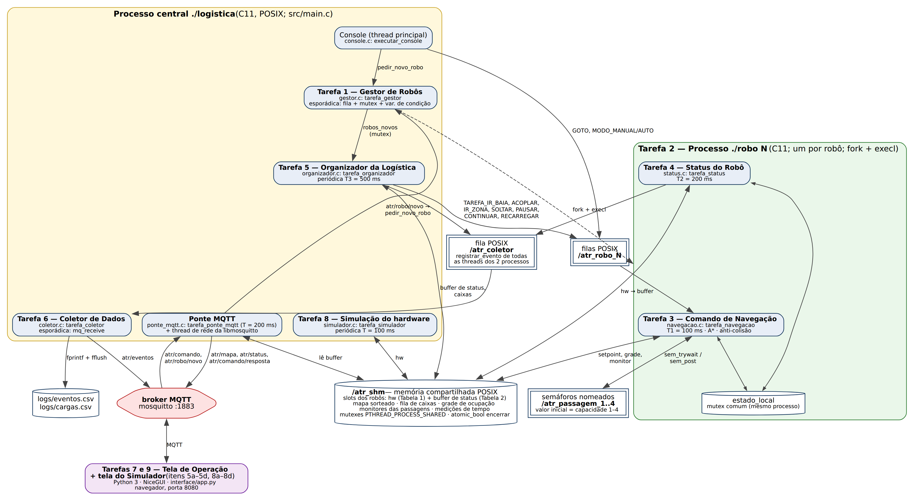

Legenda: caixas arredondadas são **threads**; os quadros amarelo e verde são
os **processos**; cilindros são **dados compartilhados**; caixas de borda dupla
são **objetos de IPC POSIX** com nome; o hexágono é o **broker MQTT**.

## 2.2 Processos, threads e linguagens

| Processo (linguagem) | Thread | Tipo | Arquivo: função |
|---|---|---|---|
| `./logistica` (C11) | principal = Console | lê stdin | `main.c: main`, `console.c: executar_console` |
| | Gestor de Robôs | esporádica (var. de condição) | `gestor.c: tarefa_gestor` |
| | Organizador da Logística | periódica, 500 ms | `organizador.c: tarefa_organizador` |
| | Coletor de Dados | esporádica (`mq_receive`) | `coletor.c: tarefa_coletor` |
| | Simulador do hardware | periódica, 100 ms | `simulador.c: tarefa_simulador` |
| | Ponte MQTT | periódica, 200 ms | `ponte_mqtt.c: tarefa_ponte_mqtt` |
| | rede da libmosquitto | callbacks | `ponte_mqtt.c: ao_conectar / ao_receber` |
| `./robo <id>` (C11), um por robô | principal | cria e espera | `robo_main.c: main` |
| | Comando de Navegação | periódica, 100 ms | `navegacao.c: tarefa_navegacao` |
| | Status do Robô | periódica, 200 ms | `status.c: tarefa_status` |
| `interface/app.py` (Python 3, NiceGUI) | laço asyncio + thread do paho-mqtt | evento / 200 ms | `app.py`, `mqtt_cliente.py`, `estado.py`, `paineis/*.py` |
| `mosquitto` | broker MQTT | — | `docker/mosquitto.conf` |

## 2.3 Mapeamento das tarefas do enunciado

| # | Tarefa do enunciado | Implementação | Observação |
|---|---|---|---|
| 1 | Gestor de Robôs (C) | `gestor.c: tarefa_gestor`, `atender_pedido`, `criar_processo_robo` | Pedido vem por MQTT (`atr/robo/novo`, publicado pelo simulador) ou pelo Console; cria o processo com `fork` + `execl`; avisa o Organizador pelo contador `robos_novos` |
| 2 | Processo de cada robô (C) | `robo_main.c: main` | Processo separado, 2 threads |
| 3 | Comando de Navegação (C) | `navegacao.c: tarefa_navegacao` | Recebe tarefas pela fila `/atr_robo_<id>`, gera um setpoint por célula (A*), troca dados com a Status pelo `estado_local`, para em DEFEITO/PAUSAR e ao içar a carga, entra nas passagens pelo semáforo + monitor |
| 4 | Status do Robô (C) | `status.c: tarefa_status` | Único escritor do buffer de status; detecta falha/bateria 0% (DEFEITO, flag `parar`); manda recarregar (flag `ir_recarregar`); soma a distância total |
| 5 | Organizador da Logística (C) | `organizador.c: tarefa_organizador` | Fila de caixas (3 por baia, `config/caixas.txt`, não ordenada), escolha da equipe, acoplamento síncrono, PAUSAR/CONTINUAR; IPC com os robôs por filas; MQTT com a tela pela Ponte |
| 6 | Coletor de Dados (C) | `coletor.c: tarefa_coletor`, `eventos.c` | Fila `/atr_coletor`; grava `logs/eventos.csv` e `logs/cargas.csv` com data e hora em ms; publica em `atr/eventos`; comando `historico` |
| 7 | Tela de Operação | `interface/app.py`, `interface/paineis/` | Mapa, cards dos robôs, caixas, eventos, gráficos, tempo real |
| 8 | Simulação | `simulador.c` (hardware), `mapa.c` (espaço), painel "Simulação" da tela | Lê o setpoint e move 1 célula por tick; bateria, recarga, garra; GUI: defeito, bateria, caixas, novos robôs |
| 9 | Tela de operação = tela do simulador | mesma página | Permitido pelo enunciado |

## 2.4 Objetos de IPC e dados compartilhados

| Recurso | Tipo | Criado em | Usado por |
|---|---|---|---|
| `/atr_shm` | memória compartilhada POSIX (`shm_open` + `mmap`) | `memoria.c: criar_memoria` | todos os processos |
| `Robo.mutex` (um por robô) | mutex `PTHREAD_PROCESS_SHARED` | `memoria.c: iniciar_mutex_compartilhado` | Simulador, Organizador, Console, Ponte, Navegação, Status |
| `mutex_caixas` | mutex `PROCESS_SHARED` | `memoria.c` | Organizador, Console, Ponte |
| `ocupacao.mutex`, `monitor[p].mutex` | mutex `PROCESS_SHARED` | `memoria.c` | Navegação de cada robô, Gestor |
| `mutex_tempos` | mutex `PROCESS_SHARED` | `memoria.c` | tarefas centrais, comando `tempos` |
| `encerrar` | `atomic_bool` (lock-free) | `memoria.c` | todos os laços |
| `/atr_robo_<id>` | fila de mensagens POSIX | `gestor.c: criar_fila_robo` | Organizador/Console → Navegação |
| `/atr_coletor` | fila de mensagens POSIX | `main.c: criar_fila_coletor` | todas as threads → Coletor |
| `/atr_passagem_1..4` | semáforos contadores nomeados | `main.c: criar_semaforos` | Navegação (entra/sai); A* e Ponte (`sem_getvalue`) |
| fila de pedidos | vetor circular + mutex + variável de condição | `gestor.c` | Console, Ponte → Gestor |
| `estado_local` | struct + mutex comum | `robo_main.c` | Navegação ↔ Status |
| `estado.py: Estado` | dicionário + `threading.Lock` | interface | thread do paho-mqtt → laço da tela |

## 2.5 Interface com o hardware e buffer de status (Tabelas 1 e 2)

Cada robô tem um **slot** na memória compartilhada (`comum.h: struct Robo`):

```c
typedef struct {            /* Tabela 1 do enunciado (comum.h) */
    int  i_posicao_x, i_posicao_y;
    bool i_carga_atracada;
    int  i_percentual_bateria;
    bool i_falha;
    int  o_sp_posicao_x, o_sp_posicao_y;
    bool o_acoplar_e_erguer;
} Hardware;

typedef struct {
    pthread_mutex_t mutex;          /* PROCESS_SHARED */
    Hardware hw;                    /* só o robô e o simulador */
    int e_posicao_x, e_posicao_y;   /* buffer de status (Tabela 2):     */
    int j_sp_posicao_x, j_sp_posicao_y; /* SÓ a thread Status escreve */
    int bateria; Estado e_estado; double distancia_total;
    ...
} Robo;
```

**Regra do buffer de status:** quem está fora do processo do robô
(Organizador, Console, Ponte MQTT) lê **só** `e_*`, `j_*`, `bateria`... e
nunca o `hw`. A Status copia o `hw` para o buffer a cada 200 ms, tudo sob um
lock, então o buffer é sempre um retrato consistente de um instante. Exceção
documentada: o simulador e os comandos que emulam o hardware (`falha`, `ok`,
`bateria`) escrevem no `hw` — eles **são** o hardware.

## 2.6 Fluxo de uma entrega

1. O Organizador (500 ms) pega a **primeira caixa da fila com a baia livre** e
   procura `tamanho` robôs DISPONIVEL, automáticos e com bateria suficiente
   para a tarefa inteira, ordenados pelo **menor caminho A\*** até a baia.
   Sem equipe completa, **não reserva ninguém** e a fila espera.
2. Com a equipe completa: escreve `carga_id` nos slots e manda
   `TAREFA_IR_BAIA` pela fila de cada robô. Cada Navegação calcula o A* e anda
   uma célula por ciclo, reservando a próxima na grade de ocupação.
3. Na baia cada robô fica `AGUARDANDO_EQUIPE`. Com **todos** nesse estado o
   Organizador manda `ACOPLAR` a todos **no mesmo ciclo**; cada robô liga
   `o_acoplar_e_erguer` e passa a `OPERANDO_CARGA` quando o simulador confirma
   `i_carga_atracada`.
4. Com **todos** em `OPERANDO_CARGA`, `IR_ZONA` (com o líder e o tamanho da
   equipe). O líder calcula o caminho e usa os semáforos das passagens; os
   seguidores andam em bloco atrás dele.
5. Com todos na zona: `SOLTAR`, registro em `logs/cargas.csv`
   (`data;caixa;baia;zona;robôs`), robôs DISPONIVEL.

# 3. Tabela de conformidade

Coluna "Teste": cenário de `testes/rodar_todos.sh` (saídas em
`testes/saidas/`), teste `pytest` da interface, benchmark ou verificação
manual na tela.

## 3.1 Tarefas 1–9

| Requisito do enunciado | Onde está (arquivo: função) | Como foi testado |
|---|---|---|
| 1. Gestor identifica robôs novos; mensagem MQTT do simulador | `ponte_mqtt.c: ao_receber` → `novo_robo` → `gestor.c: pedir_novo_robo` | Tela: botão "Criar" / clique no mapa; benchmark cria até 128 |
| 1. Gestor cria um processo por robô | `gestor.c: criar_processo_robo` (`fork` + `execl("./robo")`) | Todos os cenários ("robo criado (pid …)") |
| 1. Posição fixa ou arbitrária | `pedir_novo_robo(x, y)`; `ocupacao.c: reservar_livre_perto` | Cenários 2, 8 e 10 |
| 1. Gestor comunica o Organizador | `robos_novos` + `mutex_novos`; `pegar_robos_novos` | "Organizador: N robo(s) novo(s) na frota" em todos |
| 2. Um processo por robô, ≥ 2 threads | `robo_main.c: main` (Navegação + Status) | `ps -L` / todos os cenários |
| 3. Recebe tarefa do Organizador | `navegacao.c: ler_mensagens`, `tratar_mensagem` (fila `/atr_robo_<id>`) | Cenários 1–4, 10, 11 |
| 3. Gera setpoints; simulador muda a posição | `navegacao.c: dar_passo` → `hw.o_sp_*`; `simulador.c: mover_uma_celula` | Cenário 1 (rota A* completa) |
| 3. Troca informações com a Status | `estado_local` (`definir_estado`, flags `parar`, `ir_recarregar`) | Cenário 3 |
| 3. Impede movimento (içar carga, defeito) | `deve_parar` / `segurar_posicao`; o Organizador só manda `IR_ZONA` após todos erguerem | Cenários 2 e 3 |
| 3. Novo destino (bateria fraca) | `verificar_recarga` (flag da Status), `RECARREGAR` do Organizador | Cenários 3 e 7 |
| 3. Passagem segura em trechos estreitos | semáforo `/atr_passagem_p` + monitor de mão única (`ocupacao.c: entrar_passagem`) | Cenários 6, 9, 11; tela (semáforo vermelho) |
| 4. Buffer compartilhado com o status | `status.c: atualizar_buffer` (único escritor) | `status` em todos os cenários; `atr/status` |
| 4. Detecta falha, atualiza status e para | `status.c: verificar_defeito` → DEFEITO + `parar` | Cenários 3 e 6; `medir_falha` (latência < 300 ms) |
| 4. Bateria → recarga, indisponível enquanto recarrega | `status.c: verificar_bateria` (RECARREGANDO; volta a DISPONIVEL com 100%) | Cenários 3 e 7 |
| 4. Distância total percorrida | `status.c: atualizar_buffer` (`distancia_total`) | Coluna "dist" do `status`; gráfico da tela |
| 5. Baias com número fixo de caixas (1–4) no início | `config/caixas.txt` (3 por baia), `organizador.c: carregar_caixas` | Execução padrão (`./logistica`) |
| 5. Fila pré-definida, não ordenada | `mem->caixas[]` em ordem de chegada; `primeira_da_fila` | Cenários 4, 10, 11 |
| 5. Escolhe os robôs | `organizador.c: escolher_robos` (menor caminho A*, bateria suficiente) | Cenário 2 (robô mais longe fica de fora) |
| 5. Libera a carga só com todos em posição | `acompanhar_equipe` (ACOPLAR só com todos `AGUARDANDO_EQUIPE`; `IR_ZONA` só com todos `OPERANDO_CARGA`) | Cenário 2 (os 3 "carga erguida" em 5 ms) |
| 5. IPC com os processos dos robôs | filas `/atr_robo_<id>` (`gestor.c: enviar_para_robo`) + memória compartilhada | Todos |
| 5. Troca informações com a tela via MQTT | `ponte_mqtt.c` (`atr/status`, `atr/comando`) | Tela |
| 5a. Posição dos robôs, caixas a mover e já entregues | `paineis/mapa.py`, `paineis/caixas.py` ("mostrar entregues"), contadores | Figuras 5.1–5.3; `test_mapa_svg.py` |
| 5b. Status em tempo real com ícones | ícone/cor por estado no mapa e nos cards; legenda | Figuras; `test_cores.py` |
| 5c. Troca manual/automático | botões Auto/Manual → `manual <id>` / `auto <id>` | Cenários 8 e 9; tela |
| 5d. Setpoint manual: posição arbitrária, recarga, baia | "ir para…" (baias, zonas, estações), x/y, clique no mapa → `goto` | Cenários 8 e 9; tela |
| 6. Baia, destino e robôs de cada carga | `organizador.c: finalizar_entrega` → `logs/cargas.csv` | `testes/saidas/cenario*_cargas.csv` |
| 6. Histórico de cada robô | `registrar_evento` em Navegação/Status/Organizador ("tarefa: ir para a baia", "carga erguida", "bateria baixa: indo recarregar", "DEFEITO: robo parado"...) | `cenario*_eventos.csv`; painel Eventos com filtro por robô |
| 6. Timestamp com data e hora | `eventos.c: enviar_coletor` (`CLOCK_REALTIME` no envio); `coletor.c: formatar_data_hora` (ms) | Todos os CSV |
| 6. Em disco e disponível remotamente | `fprintf` + `fflush`; `atr/eventos` (ao vivo) e `historico [n]` (do disco) | Botão "Carregar histórico do disco" |
| 7. Tela com posições e todos os dados/comandos | `interface/app.py` + painéis | 41 testes `pytest`; capturas |
| 8. Simula o hardware (setpoint → posição) | `simulador.c: simular_robo` | Todos |
| 8. Mapa com baias e zonas | `mapa.c: gerar_mapa`; `atr/mapa` | Cenário 5; tela |
| 8. Caminhos de no máximo 1, 2, 3 robôs | 4 passagens com capacidades {1,2,3,4} sorteadas; semáforos | Cenários 5, 6, 9; capturas |
| 8a. Gerar defeitos | painel do robô "Gerar falha"/"OK" → `falha`/`ok` | Cenário 3; tela |
| 8b. Abaixar bateria | controle "Bateria" → `bateria <id> <pct>` | Cenários 3, 6, 7 |
| 8c. Incluir caixas | "Nova caixa" → `caixa <tam> <baia> <zona>` | Cenários 4, 10, 11 |
| 8d. Novos robôs | "Criar" / "Posicionar clicando no mapa" → `atr/robo/novo` | Tela |
| 9. Tela de operação = simulador | mesma página NiceGUI | — |

## 3.2 Tabelas 1 e 2, MQTT e Coletor

| Requisito | Onde está | Como foi testado |
|---|---|---|
| Tabela 1: `i_posicao_x/y`, `i_carga_atracada`, `i_percentual_bateria`, `i_falha`, `o_sp_posicao_x/y`, `o_acoplar_e_erguer` | `comum.h: Hardware`; escritos pelo simulador (`i_*`) e pela Navegação (`o_*`) | Todos |
| `o_acoplar_e_erguer` síncrono | ACOPLAR para todos no mesmo ciclo só com todos na baia (`organizador.c: acompanhar_equipe`) | Cenário 2: `20:38:31.582/.583/.587 carga erguida` (robôs 0, 1, 2) |
| Tabela 2: `e_estado`, `e_posicao`, `j_sp_posicao` | `comum.h: Robo` (buffer de status) | `status`; JSON `atr/status` |
| Passagens de 1, 2 e 3 (e 4) robôs | `mapa.c: sortear` (capacidades embaralhadas), `main.c: criar_semaforos` | Cenário 5 (duas sementes), 6, 9 |
| MQTT publisher e subscriber (C e Python) | `ponte_mqtt.c` (libmosquitto), `interface/mqtt_cliente.py` (paho-mqtt) | Tela; `test_estado.py` |
| Coletor com timestamp, disco e remoto | seção 3.1, item 6 | `logs/*.csv`, `historico`, painel Eventos |

## 3.3 Instruções gerais

| Instrução | Como foi atendida |
|---|---|
| 3. Caminhos relativos | `config/caixas.txt`, `logs/`, `./robo`, `testes/...`: tudo relativo à raiz; os scripts fazem `cd` para a raiz antes de rodar |
| 4. Documentação PDF com compilar e rodar | `docs/INSTRUCOES.pdf` (= `README.md`) e este relatório |
| 5. Executar tudo a partir de um único arquivo | `./rodar.sh` (nativo: mosquitto + tela + núcleo) ou `docker compose up --build`; o `./logistica` cria sozinho todos os processos `./robo` |
| 6. Profissionalismo e organização | Makefile sem warnings (`-Wall -Wextra`), Docker, cabeçalho "Sincronização" em cada arquivo, `docs/EXPLICACAO.md`, versionamento git |
| 7. Testar cada módulo e cada interação | 11 cenários automáticos com conferências (`rodar_todos.sh`), 41 testes `pytest` da interface, benchmark de 1 a 128 robôs |

# 4. Mecanismos de sincronização e partes críticas do código

Resumo de `docs/EXPLICACAO.md`, que traz cada mecanismo no formato
Onde / Problema / Como / Sem ele.

**Regra geral anti-deadlock:** em nenhum ponto do código uma thread segura
dois mutexes ao mesmo tempo. Cada `pthread_mutex_lock` é seguido do `unlock`
antes do próximo `lock`; quando é preciso juntar dados de dois lugares, eles
são copiados para variáveis locais. Sem "segurar um e pedir outro" não existe
espera circular entre mutexes.

## 4.1 Memória compartilhada e mutex `PROCESS_SHARED`

```c
/* memoria.c */
shm_unlink(NOME_SHM);                                    /* sobra de execução anterior */
fd = shm_open(NOME_SHM, O_CREAT | O_EXCL | O_RDWR, 0600);
ftruncate(fd, sizeof(MemoriaCompartilhada));
m = mmap(NULL, sizeof(MemoriaCompartilhada), PROT_READ | PROT_WRITE, MAP_SHARED, fd, 0);

static void iniciar_mutex_compartilhado(pthread_mutex_t *mutex) {
    pthread_mutexattr_setpshared(&atributo, PTHREAD_PROCESS_SHARED);
    pthread_mutex_init(mutex, &atributo);
}
```

- **Problema:** o simulador (processo central) escreve a posição que a Status
  (processo do robô) lê; o Organizador lê o buffer que a Status escreve.
- **Por que `PROCESS_SHARED`:** o mutex mora na memória compartilhada e é
  travado por threads de **processos diferentes**; sem o atributo o
  comportamento é indefinido.
- **Sem o mutex:** leitura "pela metade" (x novo com y antigo, buffer com
  posição nova e estado antigo).
- **Um mutex por robô:** robôs diferentes não esperam uns pelos outros.

## 4.2 Mapa sem mutex (escrito antes das threads)

`main.c` chama `gerar_mapa(&mem->mapa)` **antes** de qualquer
`pthread_create` e de qualquer `fork`. Depois disso o mapa só é lido.
Condição de corrida exige alguém escrevendo enquanto outro lê; aqui não há
escritor depois da criação, e `pthread_create`/`fork` garantem que o novo
fluxo enxerga o que foi escrito antes.

## 4.3 Produtor-consumidor com variável de condição (Gestor)

```c
/* gestor.c: tarefa_gestor (consumidor) */
pthread_mutex_lock(&mutex_pedidos);
while (quantidade == 0 && !atomic_load(&mem->encerrar))   /* while, não if */
    pthread_cond_wait(&cond_pedidos, &mutex_pedidos);
...
p = pedidos[inicio]; inicio = (inicio + 1) % MAX_PEDIDOS; quantidade--;
pthread_mutex_unlock(&mutex_pedidos);
atender_pedido(p);               /* fork/exec FORA do mutex */
```

- **Mutex:** Console, thread de rede do MQTT e Gestor mexem em `inicio` e
  `quantidade`; sem ele um pedido se perde ou é lido duas vezes.
- **Variável de condição:** o Gestor dorme sem gastar CPU com a fila vazia;
  `pthread_cond_wait` solta o mutex enquanto dorme.
- **`while`:** despertar espúrio ou aviso de encerramento — a condição é
  testada de novo.
- **`acordar_gestor`** faz o `broadcast` com o mutex travado: o aviso não cai
  entre o "testa" e o "dorme".

## 4.4 `fork` seguido de `execl`

```c
pid = fork();
if (pid == 0) {
    execl("./robo", "robo", id_texto, (char *)NULL);
    _exit(1);              /* só se o exec falhou */
}
```

O processo central tem várias threads; no filho de um `fork` só existe a
thread que chamou, e um mutex travado por outra thread ficaria travado para
sempre. O `exec` troca o programa inteiro: o robô começa limpo e abre o IPC
pelo nome.

## 4.5 Filas de mensagens

- **`/atr_robo_<id>`** (Organizador/Console → Navegação): comandos chegam sem
  se perder e em ordem. A Navegação lê com `mq_timedreceive` e prazo = agora:
  com a fila vazia volta na hora (`ETIMEDOUT`) e o ciclo de 100 ms segue.
- **`/atr_coletor`** (todos → Coletor): muitos produtores, um consumidor que
  escreve em disco (lento). `mq_send` é atômico; as tarefas periódicas não
  esperam o disco; só o Coletor escreve nos arquivos (sem mutex de arquivo).
  O **timestamp é tirado por quem envia**, no instante do evento:

```c
/* eventos.c */
clock_gettime(CLOCK_REALTIME, &msg.quando);   /* hora real do evento */
mq_send(fila, (const char *)&msg, sizeof(msg), 0);
```

## 4.6 Semáforos contadores das passagens + monitor de mão única

```c
/* ocupacao.c: entrar_passagem — nunca espera */
pthread_mutex_lock(&m->mutex);
if (m->dentro == 0 || (m->sentido == sentido && !m->esperando[1 - sentido])) {
    if (sem_trywait(sem_passagem[p]) == 0) {        /* capacidade */
        m->dentro++; m->sentido = sentido; m->esperando[sentido] = false;
        entrou = true;
    }
}
if (!entrou) m->esperando[sentido] = true;          /* tenta no próximo ciclo */
pthread_mutex_unlock(&m->mutex);
```

- O **semáforo** (valor inicial = capacidade sorteada) limita **quantos**
  robôs ficam na passagem; o **monitor** decide o **sentido**.
- `sem_trywait` e não `sem_wait`: a thread nunca fica presa (continua lendo
  `PAUSAR` e a flag `parar`) e nunca bloqueia dentro do mutex do monitor.
- `esperando[oposto]` evita **inanição** do outro lado: quem chega depois no
  sentido atual para de entrar, o túnel esvazia e o outro lado passa.
- Robô nunca segura duas passagens (regiões separadas por células livres);
  numa equipe só o líder usa o semáforo (a equipe ocupa 1 vaga).

## 4.7 `estado_local` (Navegação ↔ Status) e o "testar e mudar"

```c
/* navegacao.c: definir_estado */
pthread_mutex_lock(&estado_local.mutex);
if (estado_local.estado == DEFEITO)
    estado_local.estado_antes = e;     /* vale quando o defeito sair */
else
    estado_local.estado = e;
pthread_mutex_unlock(&estado_local.mutex);
```

Mutex comum (as duas threads são do mesmo processo). O teste e a escrita sob
o mesmo lock impedem a Navegação de apagar um DEFEITO que a Status acabou de
colocar. As flags `parar` e `ir_recarregar` são o canal Status → Navegação.

## 4.8 Tarefas periódicas sem deriva

```c
clock_gettime(CLOCK_MONOTONIC, &proximo);
while (!atomic_load(&mem->encerrar)) {
    ...trabalho do ciclo...
    somar_ms(&proximo, PERIODO_NAVEGACAO_MS);
    clock_nanosleep(CLOCK_MONOTONIC, TIMER_ABSTIME, &proximo, NULL);
}
```

Com tempo **absoluto**, o tempo do trabalho não se soma ao período (com
`sleep` relativo o atraso acumularia). `CLOCK_MONOTONIC` não pula se o
relógio do sistema for ajustado.

## 4.9 `atomic_bool encerrar` e encerramento ordenado

`encerrar` é lido em todos os laços de todos os processos. Com `bool` comum
seria condição de corrida (comportamento indefinido) e o compilador poderia
nunca reler a memória. `_Static_assert(ATOMIC_BOOL_LOCK_FREE == 2)` garante
que o atômico funciona entre processos. O `main` encerra em ordem: `encerrar
= true` → acorda e `pthread_join` no Gestor, Organizador, Simulador e Ponte →
`SIGTERM` + `waitpid` em cada robô → Coletor grava o que falta (`COLETOR_FIM`,
FIFO) → `mq_unlink`, `sem_unlink`, `shm_unlink`.

## 4.10 Deadlock e inanição no Organizador

- **Sem equipe parcial:** a caixa só é atribuída com **todos** os robôs
  livres no mesmo ciclo. Reservar 2 de 3 para uma caixa e 2 de 3 para outra
  criaria "segura e espera" + espera circular.
- **Ordem de chegada:** se a primeira caixa (com baia livre) não tem equipe,
  a fila **para**. Sem isso, caixas pequenas sempre passariam na frente e a de
  tamanho 4 sofreria inanição (cenário 4).

## 4.11 Grade de ocupação e equipe em bloco (anti-colisão)

Ver capítulo 7.2. Um mutex `PROCESS_SHARED` protege a grade 60×30: cada robô
**reserva** a próxima célula antes de andar e libera a anterior ao chegar
(no máximo 2 células por robô). A equipe anda em bloco (o líder só avança com
a equipe toda na célula dele), o que eliminou um deadlock encontrado pelo
benchmark (cenário 11).

## 4.12 Interface Python

A thread do paho-mqtt só escreve numa **loja de estado** (`estado.py`)
protegida por `threading.Lock`; cada aba do navegador lê uma **cópia** a cada
200 ms (`ui.timer`). A thread do MQTT nunca mexe na interface. A tela não
decide nada: só mostra o que o C publica e envia as mesmas linhas de comando
do Console.

# 5. Testes

## 5.1 Como rodar

```bash
make clean && make                    # zero warnings
testes/rodar_todos.sh                 # 11 cenários; avisa timeout/COLISAO/falhas
interface/.venv/bin/python -m pytest -q interface    # 41 testes da tela
```

Cada cenário é um roteiro do Console (`testes/cenarioN.txt`) com a semente
fixa (`ATR_SEMENTE`). O comando `aguarda <id> <ESTADO>` espera o robô chegar a
um estado lendo o buffer de status, o que deixa a sequência de decisões
determinística. As saídas ficam em `testes/saidas/cenarioN.txt` e as linhas
novas dos logs em `cenarioN_eventos.csv` / `cenarioN_cargas.csv`.

## 5.2 Cenários

| Cenário (semente) | O que prova |
|---|---|
| 1 (42) | 1 robô, caixa de tamanho 1: ciclo completo baia → zona pelo caminho A*, atravessando uma passagem de cada parede |
| 2 (42) | Caixa de tamanho 3 com 4 robôs: escolha pelo menor caminho A* (o robô atrás de 2 paredes fica de fora), líder = o mais perto da baia (robô 1, não o 0), `AGUARDANDO_EQUIPE` e `ACOPLAR` síncrono, equipe em bloco |
| 3 (42) | Falha de um membro no transporte: `PAUSAR` a todos, `CONTINUAR` depois do `ok`; bateria baixa: recarga só depois de soltar a carga |
| 4 (42) | Caixa de tamanho 4 com 3 robôs: espera sem reservar ninguém, a fila para (sem inanição); atendida quando o 4º robô nasce |
| 5 (1 e 2) | Mesmo roteiro com duas sementes: o comando `mapa` mostra passagens e obstáculos diferentes; nos dois mapas a caixa é entregue |
| 6 (5) | Passagem de capacidade 1 ocupada por um robô em DEFEITO (0% dentro dela, segurando a vaga): o outro robô vai pela P1 (custo dinâmico do A*) |
| 7 (42) | Bateria suficiente para a tarefa inteira: robôs com 31–38% longe da baia recebem `RECARREGAR`; 12 caixas em ~3 min sem nenhum robô chegar a 0% |
| 8 (42) | Anti-colisão frente a frente (manual + goto opostos): o robô de maior id desvia após 1 s; os dois chegam; zero `COLISAO` |
| 9 (42) | Mão única na P1 (capacidade 4): há vaga, mas o robô do sentido oposto espera o túnel esvaziar; zero `COLISAO` |
| 10 (42) | 6 robôs na mesma posição padrão e 6 caixas ao mesmo tempo: as 6 entregues, zero `COLISAO` |
| 11 (42) | O deadlock que o benchmark achou (equipes cruzando P1 e P3): com a equipe em bloco as 8 caixas são entregues |

Trechos das saídas (de `testes/saidas/`):

```text
# cenário 2 — equipe pelo A*, líder 1, acoplamento síncrono
Organizador: caixa 1 (tam 3, baia 2 -> zona C): robos 1 2 0 indo para a baia
Organizador: caixa 1: equipe completa na baia, ACOPLAR
2026-11-14 20:38:31.582;0;carga erguida
2026-11-14 20:38:31.583;1;carga erguida
2026-11-14 20:38:31.587;2;carga erguida
Organizador: caixa 1: erguida por todos, IR_ZONA C (lider 1)
Organizador: caixa 1 entregue na zona C (robos 1 2 0)

# cenário 3 — falha no transporte e recarga depois da entrega
Organizador: caixa 1: robo da equipe em DEFEITO, PAUSAR
Organizador: caixa 1: defeito resolvido, CONTINUAR
2026-11-14 20:29:31.285;0;bateria baixa: indo recarregar
2026-11-14 20:29:38.884;0;recarga completa: disponivel

# cenário 4 — caixa grande espera sem reservar robôs
Organizador: caixa 1 (tam 4) aguardando equipe: 3 robo(s) livre(s)
Organizador: caixa 1 (tam 4, baia 1 -> zona B): robos 3 0 1 2 indo para a baia

# cenário 5 — duas sementes, dois mapas
Mapa gerado com semente 1            | Mapa gerado com semente 2
  P1: parede 1, y = 3,  capacidade 1 |   P1: parede 1, y = 9, capacidade 4
  P2: parede 2, y = 3,  capacidade 3 |   P2: parede 2, y = 2, capacidade 1

# cenário 7 — bateria insuficiente para a tarefa
Organizador: robo 2 sem bateria para a caixa 1: RECARREGAR
Organizador: caixa 1 (tam 3) aguardando equipe: 2 robo(s) livre(s)

# cenário 9 — mão única
2026-11-14 20:33:50.302;0;entrou na passagem P1 (para a direita)
2026-11-14 20:33:50.605;1;esperando passagem P1 (cheia ou na contramao)
2026-11-14 20:33:52.105;1;entrou na passagem P1 (para a esquerda)

# cenário 11 — cargas.csv (data;caixa;baia;zona;robôs)
2026-11-14 20:35:29.681;1;1;A;0
2026-11-14 20:35:37.681;2;2;A;1 2
2026-11-14 20:35:40.681;3;3;A;3 4 5
```

## 5.3 Testes da interface (`pytest`)

| Arquivo | O que testa |
|---|---|
| `test_estado.py` (13) | Loja de estado: status, eventos, respostas de comando, histórico, `tempos` |
| `test_mapa_svg.py` (22) | Desenho do mapa a partir de `atr/mapa` (semente 42): paredes, passagens, robôs, rotas |
| `test_cores.py` (3), `test_desenhos.py` (3) | Cores/ícones por estado e textos dos eventos |

## 5.4 Capturas de tela (mapa aleatório, semente 42)

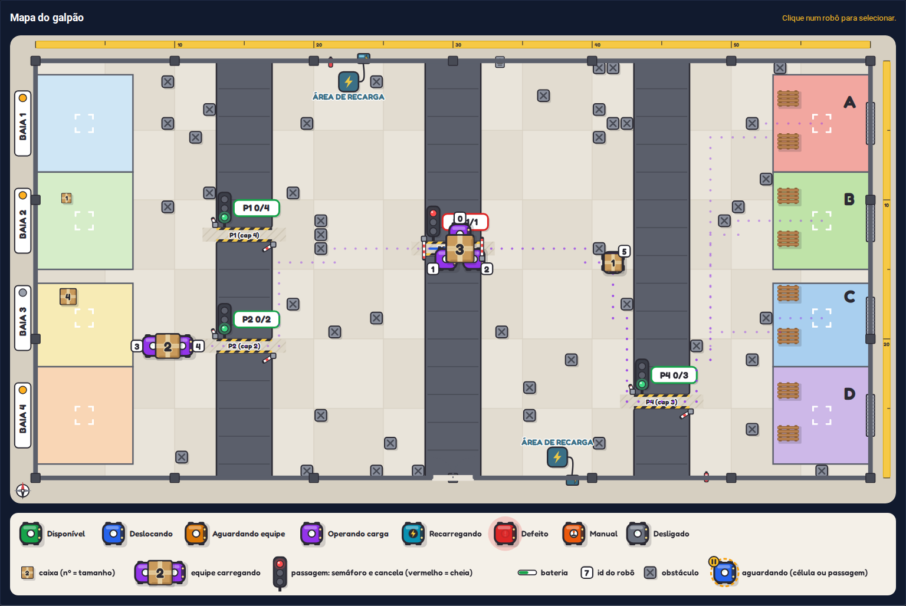

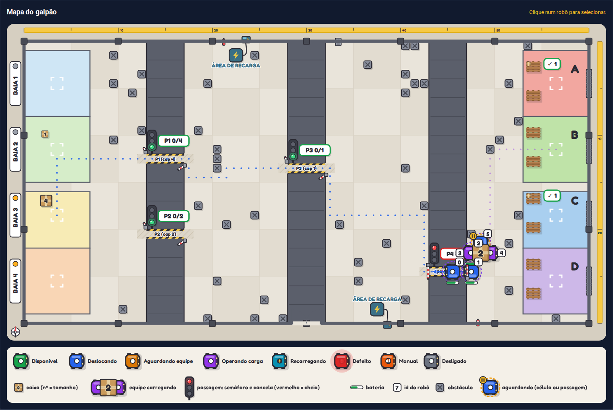

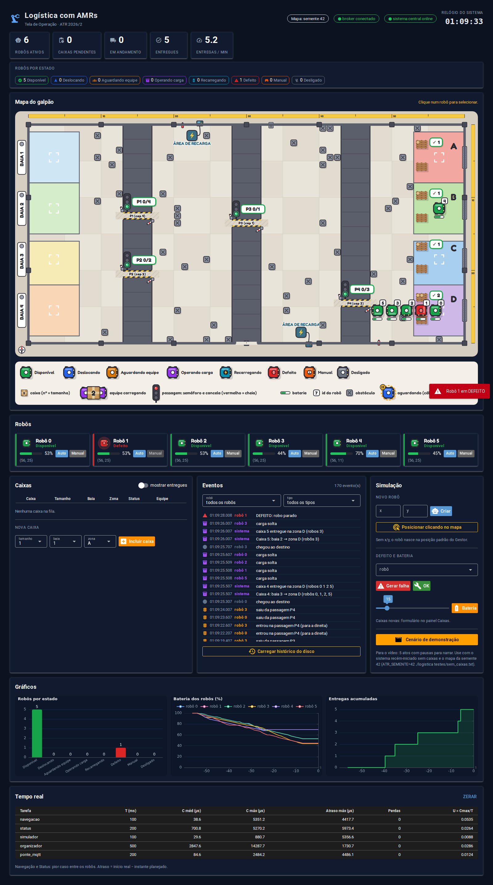

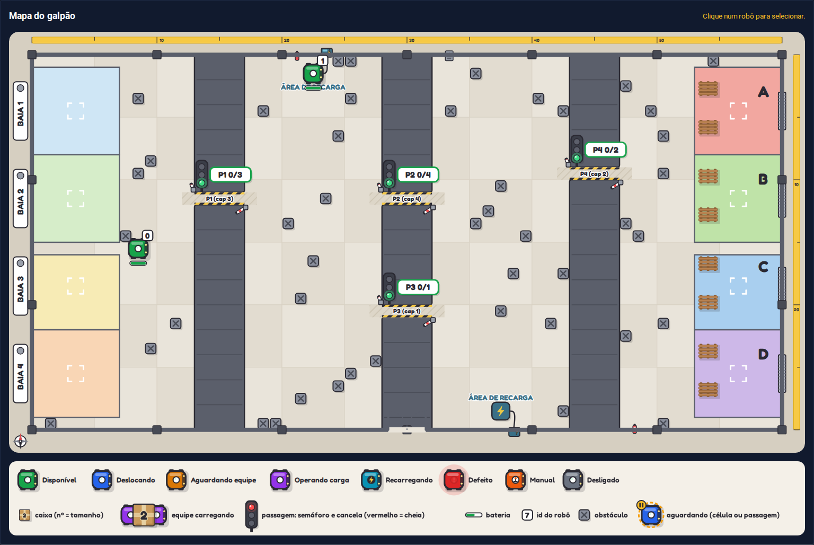

Capturas das etapas de desenvolvimento (cenário de demonstração da tela, em
5 atos):

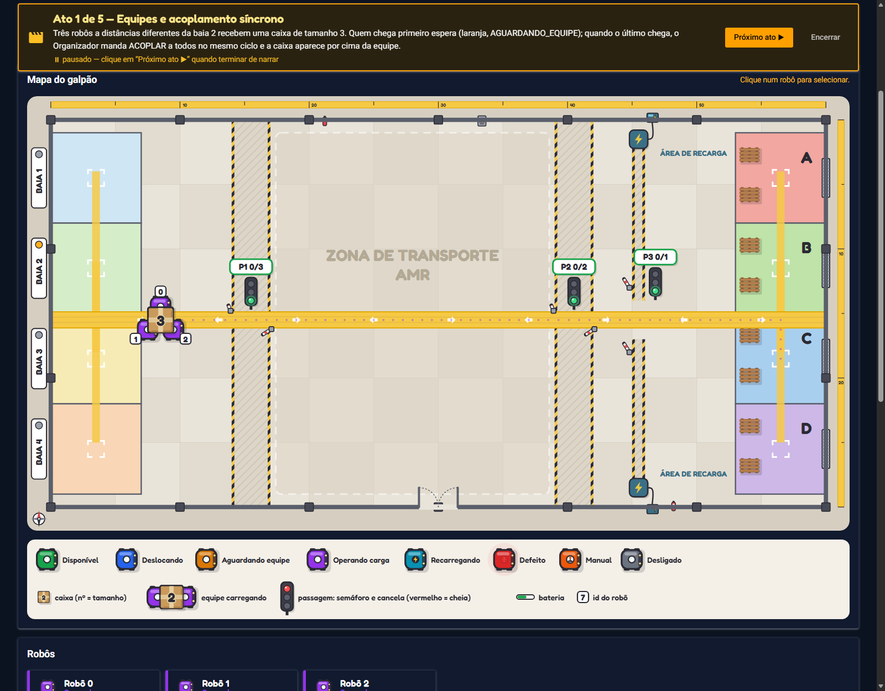

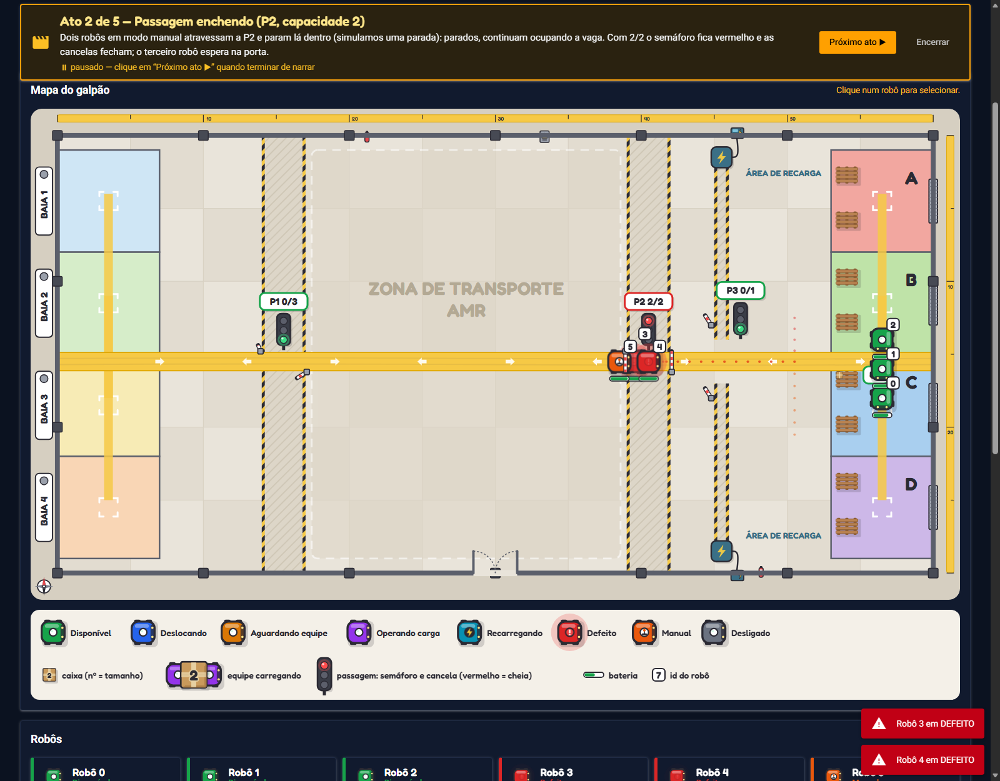

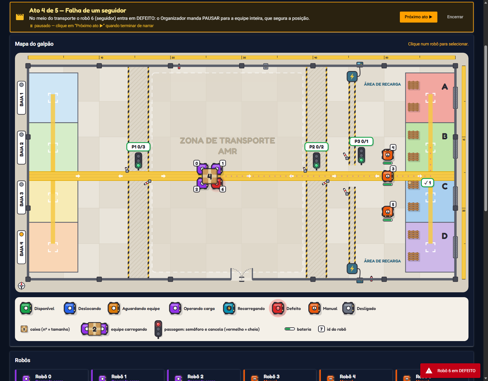

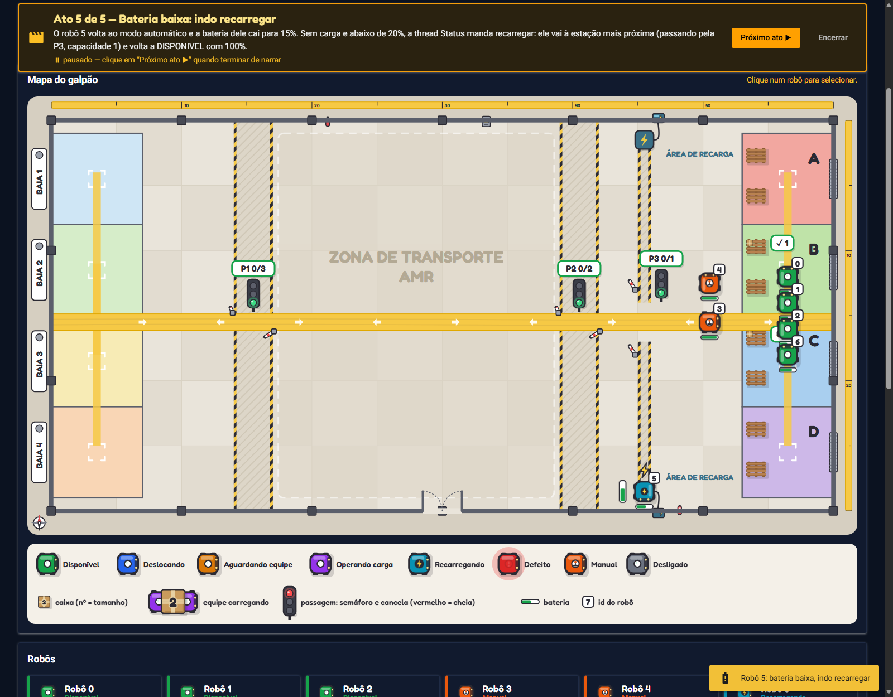

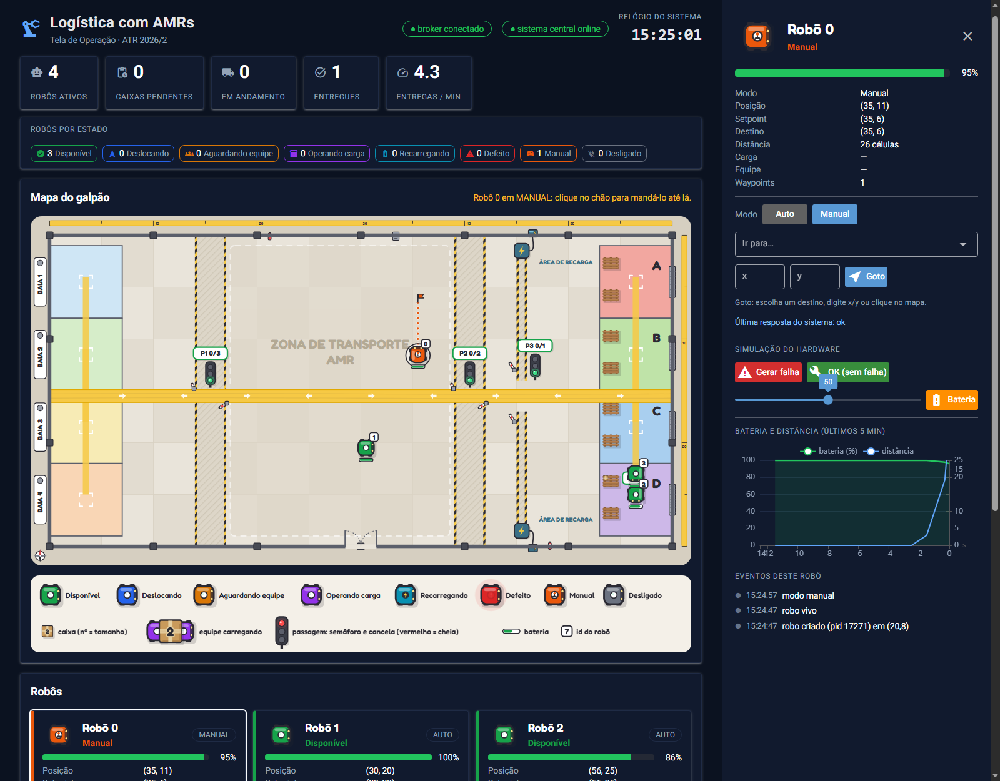

# 6. Análise de tempo de resposta e escalonabilidade

Conteúdo completo, com todas as tabelas, em `docs/ESCALABILIDADE.md` (gerado
por `testes/analisar_escalabilidade.py` a partir do benchmark).

## 6.1 Pergunta e critério

> *Num dado cenário, qual o número máximo de robôs que é possível gerir com o
> hardware de processamento utilizado de modo a garantir corretude e
> responsividade?*

- **Cenário:** semente 42, N robôs, max(2N, 64) caixas de tamanhos 1–4 (a fila
  nunca esvazia), 60 s por N, N = 1, 2, 4, 8, 12, 16, 24, 32, 48, 64, 96, 128.
- **Hardware:** Intel i5-13420H, 12 núcleos lógicos, WSL2 (Linux 6.18).
- **Corretude temporal:** **zero perdas de prazo** em todas as tarefas
  periódicas (deadline = período).
- **Responsividade:** **latência da falha < 300 ms** (`medir_falha`: do
  `i_falha` até o buffer mostrar DEFEITO; 300 ms = T_status + T_navegação).
- **Corretude lógica:** zero `COLISAO`, nenhum pedido recusado, entregas
  até o fim (sem deadlock).

## 6.2 Instrumentação

Cada tarefa periódica mede, a cada ciclo (`comum.h: medir`): atraso de
liberação (`início − instante planejado`), tempo de execução C (`fim −
início`, tempo de parede) e perda de prazo (`fim > próximo + T`). O comando
`tempos` mostra C médio/máximo, atraso máximo, perdas e U = Cmax/T (card
"Tempo real" na tela). Com `ATR_TEMPO_REAL=1` as threads usam **SCHED_FIFO
com prioridades Rate Monotonic** (Navegação e Simulador 80, Status e Ponte 70,
Organizador 60, Coletor e Gestor 50).

| Tarefa | T (ms) | Prioridade RM |
|---|---|---|
| Navegação (N) | 100 | 80 |
| Simulador | 100 | 80 |
| Status (N) | 200 | 70 |
| Ponte MQTT | 200 | 70 |
| Organizador | 500 | 60 |

## 6.3 Resultados

| N | C_nav máx (µs) | C_status máx (µs) | C_org máx (µs) | perdas | U(N) Cmáx / Cméd | lat. falha máx (ms) | entregas/min |
|---|---|---|---|---|---|---|---|
| 1 | 3407 | 2866 | 20388 | 0 | 0,098 / 0,012 | 198 | 3,0 |
| 8 | 5938 | 4961 | 56120 | 0 | 0,792 / 0,066 | 197 | 6,0 |
| 16 | 6043 | 5893 | 34344 | 0 | 1,512 / 0,174 | 194 | 9,0 |
| 32 | 3796 | 5527 | 38183 | 0 | 2,180 / 0,329 | 202 | 13,5 |
| 64 | 4086 | 6054 | 43920 | 0 | 4,645 / 0,803 | 204 | 15,0 |
| 96 | 4456 | 12798 | 61470 | 0 | 10,553 / 1,280 | 203 | 15,0 |
| 128 | 4248 | 11696 | 48076 | 0 | 13,029 / 1,172 | 202 | 15,0 |

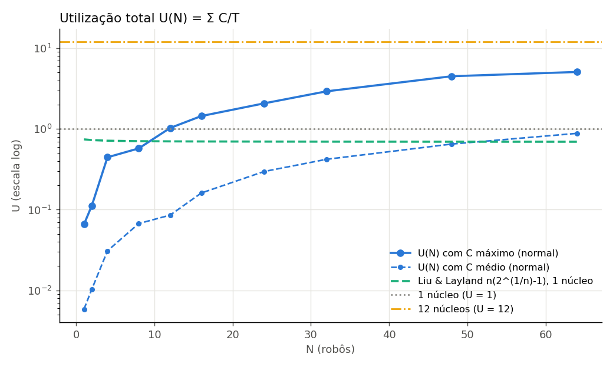

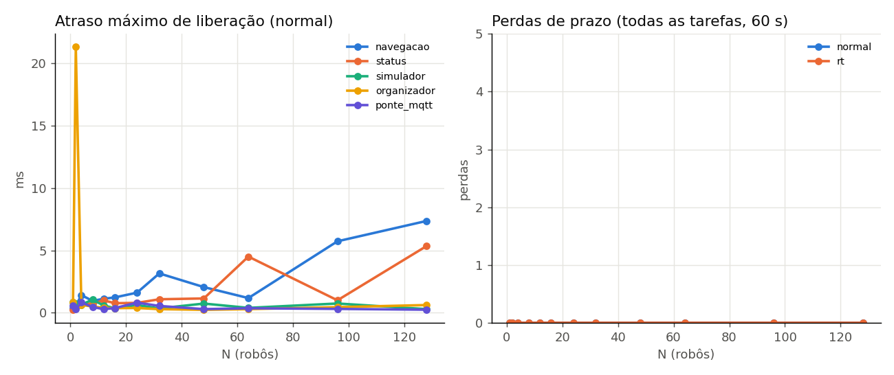

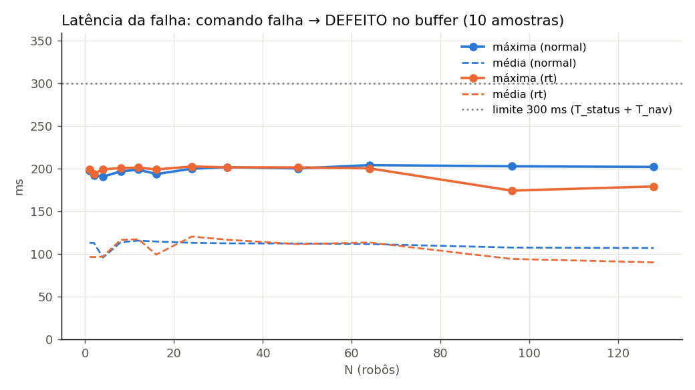

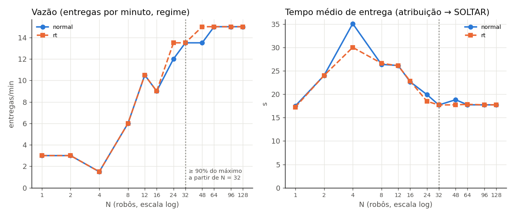

## 6.4 Liu & Layland e RTA (análise de 1 núcleo)

**Liu & Layland:** U ≤ n(2^(1/n) − 1) é condição suficiente para Rate
Monotonic em 1 processador (n = 3 + 2N tarefas). Passa até N = 4 (U = 0,365 ≤
0,715); a partir de N = 8 o teste é inconclusivo (U = 0,792 > 0,706).

**RTA (teste exato, prioridade fixa, 1 processador, D = T):**

R_i = C_i + Σ_{j ∈ hp(i)} ⌈R_i / T_j⌉ · C_j, iterando até convergir; a
tarefa é escalonável se R_i ≤ T_i. Usamos os **C máximos medidos**. A tarefa
de menor prioridade (Organizador) sofre interferência de todas: se ela passa,
todas passam.

Organizador com **N = 8**: C (ms) Navegação = 5,938 (×8), Simulador = 0,347,
Status = 4,961 (×8), Ponte = 0,517, Organizador = 56,120.

R^(k+1) = 56,120 + ⌈R^k/100⌉·(8·5,938 + 0,347) + ⌈R^k/200⌉·(8·4,961 + 0,517)

| k | R^k (ms) |
|---|---|
| 0 | 144,175 (= Σ C) |
| 1 | 192,023 |
| 2 | 192,023 → convergiu ≤ 500 ms: **escalonável** |

Com **N = 12** a iteração passa de 500 ms (164 → 222 → 354 → 412 → 544 ms):
**não escalonável num núcleo só**. Logo, **em 1 núcleo, com os C máximos, a
RTA garante até N = 8**.

## 6.5 Resposta

**Com este hardware (12 núcleos), o sistema garante corretude e
responsividade para até N = 128 robôs, o maior valor testado (= `MAX_ROBOS`):
zero perdas de prazo em todas as tarefas, latência da falha ≤ 204 ms
(< 300 ms), zero colisões, nenhum pedido recusado e entregas até o fim.**

- **CPU:** com 128 robôs a carga média é U ≈ 1,2 de 12 núcleos. A reta com os
  C máximos (pico de um robô somado como se todos tivessem o pico em todo
  ciclo) chegaria a 12 núcleos em N ≈ 118 — um limite pessimista, abaixo do
  que foi medido sem perdas. Com o C médio, N ≈ 1320.
- **Sistema operacional:** o primeiro limite rígido acima de 128 é
  `/proc/sys/fs/mqueue/queues_max` = 256 filas POSIX → **255 robôs** (uma fila
  por robô + a do Coletor). Depois vem `RLIMIT_MSGQUEUE` (~600 robôs).
- **Galpão:** a vazão satura em **15 entregas/min a partir de N ≈ 64**: há 4
  baias e uma carga por baia de cada vez. Robôs além disso são gerenciáveis,
  mas ficam no estacionamento.
- **Num núcleo só** (RTA, C máximos): N = 8.
- **SCHED_FIFO (Docker, `SYS_NICE`):** também zero perdas; o pior atraso de
  liberação caiu de 21,3 ms para 5,6 ms. A latência e a vazão quase não
  mudam (dominadas pela fase do ciclo da Status e pelas baias).

## 6.6 Limitações da análise

Linux não é RTOS (nem com SCHED_FIFO); WSL2 é uma máquina virtual e o Windows
pode tirar a CPU do Linux inteiro; C máximo observado em 60 s não é o WCET;
a RTA de 1 núcleo ignora bloqueio por mutex e troca de contexto; o benchmark
roda sem a tela; uma semente e uma rodada por N.

# 7. Pontos extras

Este capítulo existe só para dizer **o que foi feito além da especificação e
por que merece a pontuação extra**, como pede a instrução geral 8.

## 7.1 Extra +3 — IA de rotas e cargas com mapa aleatório

> Enunciado: "implementar sistema de Inteligência Artificial que faça a
> otimização das rotas de cada robô e de cada carga, implementando um mapa com
> obstáculos aleatórios a cada nova execução, incluindo pontos de passagem
> limitada (apenas 1, 2, 3 ou 4 robôs por vez)".

| Parte do pedido | O que foi feito | Onde |
|---|---|---|
| Mapa aleatório a cada execução | Grade 60×30, 3 paredes; semente `ATR_SEMENTE` (sem ela, a hora). Sorteia a posição das 4 passagens (uma parede recebe 2) e 45 obstáculos; valida com **BFS** que toda baia alcança toda zona, estação e a posição padrão (até 100 tentativas) | `mapa.c: gerar_mapa`, `sortear`, `bfs`, `mapa_conectado` |
| Passagens de 1, 2, 3 ou 4 robôs | Capacidades {1, 2, 3, 4} **embaralhadas** (Fisher–Yates); um **semáforo contador** por passagem com valor inicial = capacidade | `mapa.c: sortear`, `main.c: criar_semaforos` |
| Otimização das rotas de cada robô | **A\*** com heurística de Manhattan (admissível e consistente → caminho ótimo), vizinhança 4. **Custo dinâmico:** entrar numa passagem custa `1 + 3 × (robôs dentro)` e `+30` se ela está ocupada no sentido contrário. Esperando mais de 3 s na porta, o robô **replaneja** | `mapa.c: calcular_caminho_evitando`, `custo_passo`; `navegacao.c: talvez_replanejar` |
| Otimização de cada carga | A equipe são os robôs de **menor caminho A\*** até a baia (não a distância em linha reta); o **líder** é o mais perto da baia (menor caminho posição → baia → zona); o robô só é escolhido se a **bateria basta para a tarefa inteira** (robô → baia → zona → estação mais próxima, /5 + 10%); quem não basta recebe `RECARREGAR` | `organizador.c: escolher_robos`, `formar_equipe`, `mandar_recarregar` |

**Como testar:** `ATR_SEMENTE=1 ./logistica` e `ATR_SEMENTE=2 ./logistica`,
comando `mapa` (cenário 5); cenário 2 (equipe e líder pelo A*); cenário 6
(passagem cheia evitada); cenário 7 (bateria da tarefa inteira). Na tela, a
rota A* de cada robô aparece pontilhada e muda a cada semente.

**Por que merece:** cobre **todas** as partes da frase do enunciado — mapa e
obstáculos aleatórios, passagens com as quatro capacidades, otimização de
rota (A* ótimo + custo dinâmico + replanejamento) **e** de carga (equipe,
líder e bateria decididos pelo mesmo A*). Tudo é reprodutível pela semente e
explicado passo a passo em `docs/EXPLICACAO.md` (seção 7, com um exemplo
numérico do A* numa grade 5×3). O A* é a busca heurística informada clássica
da IA: completa e ótima com heurística admissível.

## 7.2 Extra +2 — Anti-colisão descentralizada

> Enunciado: "implementar sistema descentralizado anti-colisão, em cada robô,
> sem precisar tomar tempo de processamento do Organizador da Logística".

Toda decisão de colisão acontece na **thread de Navegação de cada robô**
(`navegacao.c` + `ocupacao.c`). O Organizador **nunca é consultado**: não há
controlador de tráfego. O custo é O(1) por passo (testar e marcar 1 célula
sob um mutex), fora o A* ocasional do desvio.

| Mecanismo | O que faz | Onde |
|---|---|---|
| Grade de ocupação | Matriz 30×60 (`n`, `grupo`) + 1 mutex `PROCESS_SHARED`. Protocolo: **reservar** a próxima célula antes de escrever o setpoint; ao chegar, **liberar** a anterior. Cada robô segura no máximo 2 células. Membros da mesma equipe (grupo `1000 + carga`) entram nas células uns dos outros | `ocupacao.c: reservar_celula`, `liberar_celula`; `navegacao.c: dar_passo`, `confirmar_chegada` |
| Mão única nas passagens | **Monitor** (mutex + `dentro`, `sentido`, `esperando[2]`) + o semáforo da capacidade: entra se o túnel está vazio ou no mesmo sentido sem ninguém esperando do outro lado (sem inanição). Resolve o problema clássico da "ponte de uma via" | `ocupacao.c: entrar_passagem`, `sair_passagem` |
| Desvio com desempate | Bloqueado pela grade por mais de 1 s: A* tratando como obstáculo as células de outros grupos (cópia local da grade; A* sem mutex). O de **maior grupo/id** desvia com 10 ciclos, o outro só com 30 — os dois nunca desviam juntos | `navegacao.c: hora_de_desviar`, `desviar`; `ocupacao.c: copiar_ocupadas` |
| Equipe em bloco | O líder só avança com a equipe toda na célula dele (contagem na grade): nunca há célula livre entre líder e seguidores, então nenhum robô de fora entra no meio da equipe | `navegacao.c: equipe_junta`, `seguir_lider` |
| Robô ocioso não bloqueia | Robô DISPONIVEL parado fora de um estacionamento (zonas, estações, posição padrão) vai sozinho para o mais próximo | `navegacao.c: talvez_estacionar` |
| Verificação | O simulador confere, a cada 100 ms, se dois robôs de grupos diferentes estão na mesma célula e registra `COLISAO` | `simulador.c: conferir_colisoes` |

**Deadlock eliminado:** o benchmark com 8 robôs encontrou uma espera circular
(P3 com o líder 3 → seguidores do 3 → células da equipe 2 → P3). As regras
"equipe em bloco" e "ocioso não bloqueia" quebram a **espera circular** (das
4 condições de Coffman, as outras três são do próprio problema). Com o código
antigo o cenário 11 travou em 2 de 5 rodadas; com as regras, entrega as 8
caixas sempre.

**Como testar:** cenários 8 (frente a frente + desvio), 9 (mão única), 10
(6 robôs nascendo juntos) e 11 (deadlock); o `rodar_todos.sh` confere zero
`COLISAO`. Benchmark: zero `COLISAO` até 128 robôs. Na tela, robô aguardando
tem borda tracejada amarela e a passagem ocupada mostra a seta do sentido.

**Por que merece:** é descentralizado de verdade (o Organizador não executa
nenhuma linha de anti-colisão), trata os três tipos de conflito (célula,
passagem em sentidos opostos, travamento frente a frente), é verificável
automaticamente (`COLISAO`) e foi validado com até 128 robôs, inclusive
corrigindo um deadlock real encontrado por teste.

## 7.3 Outras melhorias além do pedido

| Melhoria | Descrição |
|---|---|
| Tela web com gráficos | NiceGUI no navegador: mapa SVG desenhado a partir do `atr/mapa`, cards dos robôs com bateria, rota A*, notificações de DEFEITO, gráficos (robôs por estado, bateria, entregas acumuladas) e o card "Tempo real" |
| Cenário de demonstração | Botão "Cenário de demonstração": 5 atos com pausa para narrar (formação de equipe, passagem cheia, caixa grande esperando, falha, recarga), sem decidir nada pelo sistema — só envia os comandos do operador |
| Prioridades Rate Monotonic opcionais | `ATR_TEMPO_REAL=1`: SCHED_FIFO com prioridades RM; comparação medida normal × tempo real |
| Medição de tempo real embutida | `tempos` / `medir_falha`; benchmark automático de 1 a 128 robôs com gráficos, Liu & Layland e RTA |
| Docker | `docker compose up --build` sobe broker, núcleo e tela; `SYS_NICE` para o modo tempo real |
| Testes automatizados | 11 cenários com conferências automáticas + 41 testes `pytest` |
| Histórico remoto | Comando `historico [n]` lê os CSV do disco e a tela mostra ("Carregar histórico do disco") |
| Execução com um comando | `./rodar.sh` (nativo) e empacotamento `./empacotar.sh` |

# 8. Simplificações e limitações assumidas

A lista completa (38 itens) está em `docs/EXPLICACAO.md`, seção 9. As
principais:

1. O galpão é uma grade 60×30; o robô anda 1 célula por tick de 100 ms do
   simulador; a bateria cai 1% a cada 5 células e sobe 2% por tick na estação.
2. O mapa é sorteado só no início; obstáculos são células isoladas e nunca
   ficam nas áreas das baias/zonas nem nas bocas das passagens.
3. Baias, zonas, estações e a posição padrão são **estacionamentos**: aceitam
   vários robôs sem controle de colisão.
4. Uma carga por baia de cada vez (no máximo 4 entregas simultâneas — o que
   limita a vazão).
5. A equipe anda em bloco (transporte ~2× mais lento que um robô sozinho); o
   líder é fixo durante o transporte.
6. Se um membro fica em DEFEITO para sempre, a equipe fica pausada para
   sempre (não há reatribuição da caixa).
7. `goto` só em modo manual; `manual` só com o robô DISPONIVEL; robô em manual
   não vai recarregar sozinho.
8. O buffer de status tem até 200 ms de atraso em relação ao estado interno.
9. A morte inesperada de um processo `robo` não é detectada.
10. `mq_send` bloqueia com a fila cheia (10 mensagens).
11. `Ctrl+C` mata tudo sem limpeza; as sobras de IPC são removidas na
    próxima inicialização (`unlink` antes de criar).
12. O C medido é tempo de parede (inclui preempção), não tempo de CPU.
13. O A* usa busca linear na lista aberta (sem heap): suficiente para 1800
    células.
14. O custo dinâmico usa uma leitura instantânea (`sem_getvalue`) que pode
    ficar desatualizada; nada de segurança depende dela.

# 9. Papel de cada integrante

| Integrante | Matrícula | Papel no trabalho (partes do código e da documentação) |
|---|---|---|
| [PREENCHER] | [PREENCHER] | [PREENCHER] |
| [PREENCHER] | [PREENCHER] | [PREENCHER] |
| [PREENCHER] | [PREENCHER] | [PREENCHER] |

# 10. Conclusão

O sistema cumpre todas as tarefas do enunciado com as ferramentas da
disciplina, cada uma no ponto em que resolve um problema concreto: memória
compartilhada com mutexes `PROCESS_SHARED` para o estado dos robôs entre
processos; filas de mensagens para comandos e para o registro de eventos;
semáforos contadores para a capacidade das passagens; variável de condição
para o Gestor dormir sem espera ocupada; tarefas periódicas com
`clock_nanosleep` absoluto; e MQTT para a operação remota.

Deadlock e inanição foram tratados por **regras de projeto** — nunca dois
mutexes ao mesmo tempo, nenhuma equipe parcial, fila por ordem de chegada,
mão única com `esperando[]`, equipe em bloco — e conferidos por testes
automáticos, um deles reproduzindo um deadlock real que o benchmark
encontrou.

A análise temporal respondeu à pergunta do enunciado com medições: neste
hardware, **até 128 robôs com zero perdas de prazo e latência de falha abaixo
de 300 ms**; em um único núcleo a RTA garante 8; o primeiro limite rígido é o
do SO (255 robôs) e o limite prático é o galpão (vazão máxima a partir de
~64 robôs). Os dois pontos extras (IA de rotas com mapa aleatório, +3, e
anti-colisão descentralizada, +2) estão completos, testados e descritos no
capítulo 7.
